# 🎮 NGCD ODE — Menú, Firmware y Medios para el Neo Geo CD

[English](README.md) · [Português](README.pt.md) · **Español**

Menú (`BOOT.ISO`), firmware (`.WAD`: loader + MCU) y herramientas para el **Neo CD SD Loader** del proyecto **[NeoCDSDLoader](https://github.com/furrtek/NeoCDSDLoader)**, por **Rodrigo Tadeu "CyberRep"**. El SD Loader cambia la unidad de CD de tu **Neo Geo CD** por una **tarjeta SD**; este proyecto cambia el menú actual por un **menú completo**, al estilo de los menús ODE: portadas, pantallas, vídeos, favoritos, estadísticas, música y 6 modos de vista. Todo en **3 idiomas** (Español, Português, English), en el **Front Loader** y en el **Top Loader**.

> 🌐 **Empieza aquí — prepara tu tarjeta SD en el navegador, sin instalar nada:** **[https://cyberrep.github.io/ngcdode/](https://cyberrep.github.io/ngcdode/)** (Chrome o Edge en el ordenador). La página copia el menú y el firmware, convierte las portadas, pantallas y textos de tus juegos y graba todo en la tarjeta.

> **¿Prefieres hacerlo en el PC, o necesitas convertir juegos?** Ejecuta **`generate_usb.py`** — un **único archivo** que arregla los discos (`.chd`, `.nrg`, `.img`, `.iso` + mp3, `.zip`/`.7z`), descarga el arte, convierte portadas, pantallas y vídeos, arma los textos de los juegos y copia el menú y el firmware a la tarjeta.

**Versiones actuales:** menú **1.0** · firmware **NGCD 00.12** (loader NGCD 12 · MCU NGCD 00.12 · CPLD 00.03) · [historial completo](CHANGELOG.es.md)

> ⚠️ **Requisito:** un **Neo CD SD Loader** (del proyecto NeoCDSDLoader) instalado en la consola. No funciona en la CDZ. Los juegos y la BIOS **no** se incluyen.

---

## ✨ Destacados

| | |
|---|---|
| 🖼️ **6 modos de vista** | Lista, Portadas, Carrusel, **Carrusel FX** (portadas giradas hacia el centro, con reflejo en el suelo y deslizamiento), **Vitrina** y **Franja**. |
| 🎬 **Vista previa en vídeo** | Detente en un juego y la imagen se convierte en su vídeo, directo de la tarjeta. |
| 🎨 **Totalmente personalizable** | 10 fondos, lo que aparece en el menú principal, el orden de la lista, la pantalla con la que arranca la consola, las letras, el sonido. [Ver todo](#-a-tu-manera). |
| ⚡ **Portadas al instante** | Portadas y pantallas en un **paquete** (`.pak`): el menú abre el paquete una vez y va directo a la imagen. Las vecinas ya están en memoria antes de llegar a ellas. |
| 💾 **Partidas en la tarjeta** | Gestor de almacenamiento: copia, restaura y borra las partidas de la memoria de la consola, y hace la copia entera de ella en la tarjeta. |
| 📊 **Espacio de la SD y la NVRAM** | Barras arriba del menú principal, con el espacio libre de cada una. |
| 🔄 **Firmware desde la consola** | Actualiza el loader y el MCU desde el propio menú, eligiendo el `.WAD`. |
| 🛟 **Siempre recuperable** | Modo seguro al encender y el menú original del SD Loader a un botón de distancia. [Ver](#-menú-de-emergencia-modo-seguro). |
| 🌐 **Página web** | Prepara la tarjeta entera en el navegador: menú, firmware, portadas, pantallas, textos y opciones. |

## 📋 Todo lo que hace

| | |
|---|---|
| 🖼️ **6 modos de vista** | Lista, Portadas, Carrusel, Carrusel FX, Vitrina y Franja. |
| 🎬 **Vista previa en vídeo** | En la lista, leída poco a poco de la tarjeta mientras se reproduce. |
| ⭐ **Favoritos, Recientes y Estadísticas** | Ranking de los más jugados y contador de partidas. |
| 🔎 **Filtro y orden** | Filtra por género y país; ordena por nombre o más jugados. |
| 📝 **Ficha de cada juego** | Título oficial, año, país, género, desarrolladora, editora y la descripción completa, en 3 idiomas. |
| 💾 **Partidas** | Gestor consola ↔ tarjeta SD, copia y restauración de la memoria entera. |
| 🧰 **Herramientas de la consola** | Prueba de control, ajuste de imagen, información de la consola y del SD Loader, **extracción de la BIOS** de tu consola. |
| 💿 **Unidad de CD** | Con la unidad conectada junto al SD Loader, la caja **CD** del menú principal arranca el disco que está en el lector. |
| 🔄 **Firmware desde la consola** | Actualización del loader y del MCU desde el menú. |
| 🎵 **Sonido** | Efectos de sonido, 10 músicas de fondo y volumen en barra. |
| 🌐 **3 idiomas** | Español, Português y English, cambiados al instante. |
| 🛠️ **Un solo archivo para preparar la tarjeta** | `generate_usb.py` arregla los discos, descarga el arte, convierte todo y copia el menú. |

---

## 📸 Pantallas

<table>
<tr>
<td align="center"><b>Menú principal</b><br>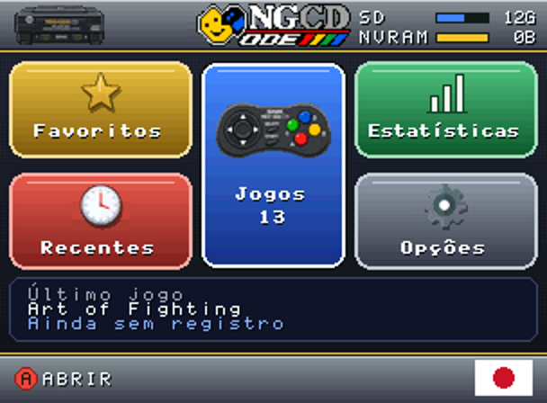</td>
<td align="center"><b>Descripción del juego</b><br>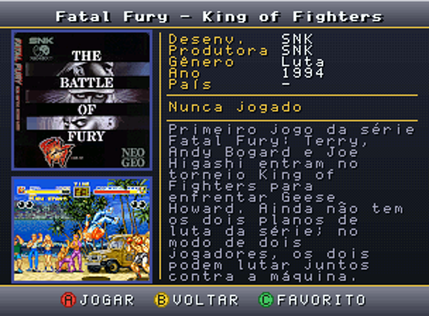</td>
</tr>
<tr>
<td align="center"><b>Lista</b><br>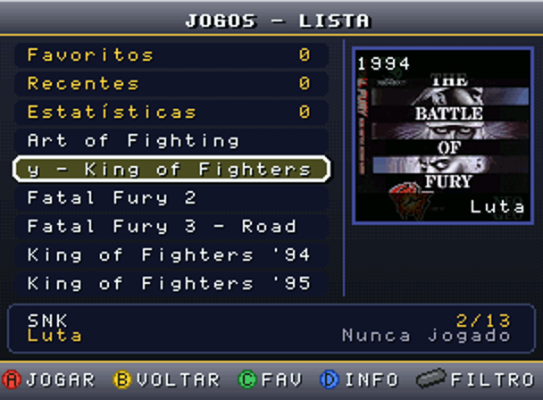</td>
<td align="center"><b>Portadas</b><br>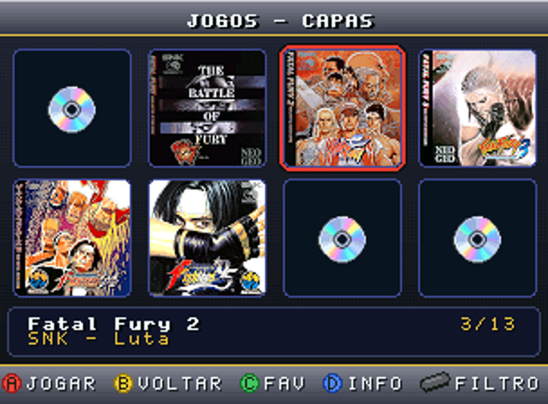</td>
</tr>
<tr>
<td align="center"><b>Carrusel</b><br>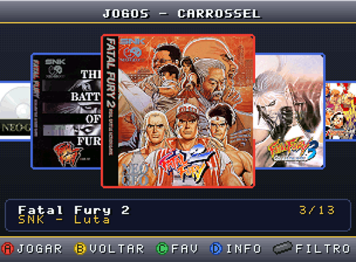</td>
<td align="center"><b>Carrusel FX</b><br>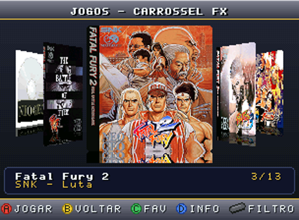</td>
</tr>
<tr>
<td align="center"><b>Vitrina</b><br>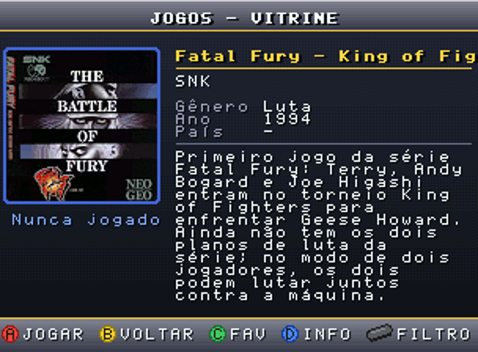</td>
<td align="center"><b>Franja</b><br>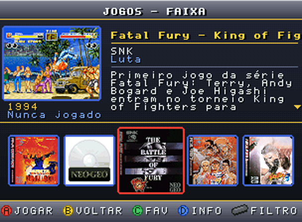</td>
</tr>
<tr>
<td align="center"><b>Opciones</b><br>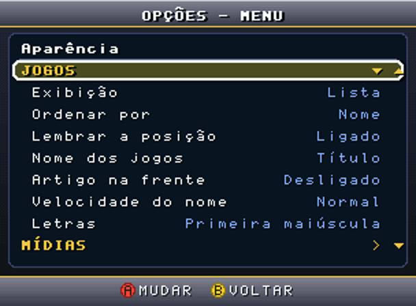</td>
<td align="center"><b>Filtro</b><br>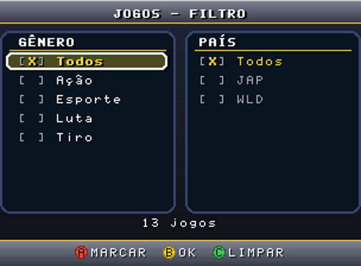</td>
</tr>
<tr>
<td align="center"><b>Dispositivo SD Loader</b><br>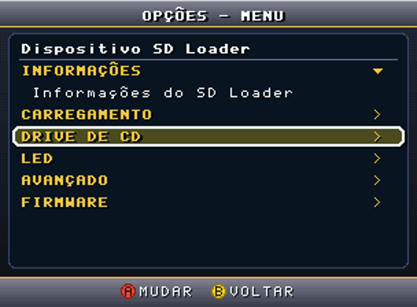</td>
<td align="center"><b>Unidad de CD</b><br>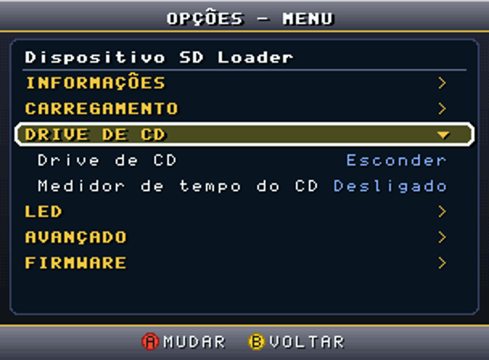</td>
</tr>
</table>

<sub>Pantallas en portugués; el menú también funciona en español e inglés.</sub>

---

## 🎨 A tu manera

El menú es **totalmente personalizable**, y todo se guarda solo en la tarjeta (`.config/ngcdconfig.ode`, un archivo de texto que se puede abrir en el Bloc de notas).

| Lo que eliges | Opciones |
|---|---|
| **Cómo ver los juegos** | 6 modos: Lista, Portadas, Carrusel, Carrusel FX, Vitrina, Franja. |
| **El fondo de las pantallas** | 10 fondos: Estándar, Fibra de carbono, Acero cepillado, Panal, Rayas, Rejilla, Chapa, Viñeta, Puntos, Liso. |
| **Lo que aparece en el menú principal** | Favoritos, Recientes, Estadísticas y Último juego: en el menú, dentro de Juegos, en los dos o en ninguno. Barra de la SD, barra de la NVRAM y bandera de la región: mostrar u ocultar. |
| **Dónde arranca la consola** | Menú principal, Juegos, Favoritos o Recientes. |
| **La lista** | Orden por nombre o más jugados; nombre oficial o nombre de la carpeta; con o sin el artículo delante; recordando o no la última posición. |
| **Lo que aparece al lado de la lista** | Nada, la portada, la pantalla o el vídeo del juego, con la información sobre la imagen o debajo, y la transparencia de las bandas. |
| **Los textos** | Primera mayúscula, MAYÚSCULAS o minúsculas; 5 velocidades para los nombres largos; 3 idiomas. |
| **El sonido** | Efectos activados o no, 10 músicas o una al azar, volumen en barra. |
| **El reposo** | Protector de pantalla a 1, 3, 5 o 10 minutos, o apagado. |
| **El SD Loader** | Región del juego, logo al encender y los colores de los LED. |

---

## 🧩 Qué hay en el firmware (`.WAD`): loader, MCU y CPLD

El Neo CD SD Loader tiene **tres partes programables**, y un único archivo **`.WAD`** trae las tres. Es el que copias a la raíz de la tarjeta para instalar o actualizar.

| Parte | Qué es | Dónde funciona | Qué hace |
|---|---|---|---|
| **Loader** (firmware del loader) | Un parche (*patch*) de la BIOS de la consola | En el procesador del Neo Geo CD (68000) | Arranca la consola desde la tarjeta, carga los juegos como si fueran CD, reproduce el audio del CD, el **menú durante el juego** (trucos, Soft DIPs), región y animación al encender. **En NGCD carga nuestro menú solo** al encender. |
| **MCU** | El programa del microcontrolador del SD Loader | En el microcontrolador (STM32) del SD Loader | Lee la tarjeta SD (FAT32), entrega los "sectores del CD" a la consola, graba las partidas y enciende los LED. **En NGCD ganó comandos de archivo**: abrir, leer en cualquier punto (*seek*), grabar, listar, crear carpetas, borrar y renombrar, y el espacio de la tarjeta. |
| **CPLD** | La lógica de hardware del SD Loader | En el chip lógico del SD Loader | El puente entre la consola y el microcontrolador. **No cambia**: es la misma del proyecto original. |

### Versiones

| | Original de NeoCDSDLoader | NGCD ODE |
|---|---|---|
| Archivo | `NSDL0011.WAD` | `NSDLZZZZ.WAD` |
| Loader | 0.11 (menú de carpetas del SD Loader) | **NGCD 12**: carga el menú NGCD al encender |
| MCU | 00.11 | **NGCD 00.12**: comandos de archivo, *seek*, espacio de la SD |
| CPLD | 00.03 | 00.03 (el mismo) |
| Menú | lista de carpetas | **NGCD 1.0** (`.boot/BOOT.ISO`) |

**Por qué importa el MCU nuevo:** con el MCU 00.11, la consola solo sabe "leer el CD" de un juego. Con **NGCD 00.12**, el menú lee y graba archivos en la tarjeta. Eso permite portadas, pantallas y vídeos fuera del `BOOT.ISO` (carpeta `.media`), los paks, las opciones en `.config`, el gestor de partidas, la extracción de la BIOS y la actualización del firmware desde el menú. El menú también funciona con el MCU 00.11, solo que sin esas funciones.

El menú lo muestra todo en *Opciones → Dispositivo SD Loader → Información del SD Loader*: el loader, el MCU, el CPLD y el número de serie del SD Loader.

---

## 🔌 Primera instalación (cómo grabar la primera actualización)

1. **Formatea la tarjeta SD en FAT32.** Los nombres de archivos y carpetas deben ser solo ASCII (sin acentos).
2. **Graba la tarjeta con la [página](https://cyberrep.github.io/ngcdode/)** (o con `generate_usb.py`). Copia:
   - el menú a `.boot/BOOT.ISO`;
   - el firmware **`NSDLZZZZ.WAD`** a la **raíz** de la tarjeta;
   - las portadas, pantallas y textos de tus juegos a `.media` y `.config`.
3. **Deja solo un `.WAD` en la raíz.** El SD Loader usa el primero que encuentra. Los demás pueden quedarse en la carpeta `.wad`.
4. **Enciende la consola.** El SD Loader detecta el firmware nuevo y lo graba solo: el **LED azul** parpadea durante la grabación (cerca de 1 minuto, **no apagues ni quites la tarjeta**), luego **verde, verde, verde** y la consola se reinicia ya con el menú NGCD.
5. **Si no graba solo:** enciende **manteniendo A, B, C o D** para abrir el menú original del SD Loader y elige **C → Update firmware**. Graba el `.WAD` de la raíz.

Una vez instalado, el menú guarda el `.WAD` en la carpeta **`.wad`** (copia) y lo quita de la raíz, para que el SD Loader no lo regrabe en cada encendido. Las siguientes actualizaciones se hacen desde el propio menú: *Opciones → Dispositivo SD Loader → Firmware → Actualizar el loader*, que lista los `.WAD` de la raíz y de la carpeta `.wad` para que elijas.

**Para volver al firmware original:** deja solo el `NSDL0011.WAD` oficial en la raíz y actualiza de la misma forma.

---

## 🛟 Menú de emergencia (modo seguro)

Si algo sale mal (tarjeta sin el menú, menú borrado, actualización a medias), la consola **siempre** tiene una salida:

| Situación | Qué hacer |
|---|---|
| **Encender manteniendo A, B, C o D** | Abre directo el **menú original del SD Loader** (lista de carpetas), sin el menú NGCD. Allí, **C → Update firmware** graba el `.WAD` de la raíz. |
| **Pantalla de aviso** (la tarjeta no tiene la carpeta `.boot`) | **A** = menú original del SD Loader · **C** = actualizar con el `.WAD` de la raíz. |
| **LED rojo, rojo, rojo** | No hay firmware válido en el SD Loader. El modo **DFU** (USB) queda activo para el rescate desde el ordenador. |

El menú NGCD se carga de la carpeta `.boot` de la tarjeta. Si grabas la tarjeta de nuevo con la página, vuelve.

---

## 💡 LED

El SD Loader tiene un LED de colores. **En el uso normal**, eliges los colores en *Opciones → Dispositivo SD Loader → LED*:

| Opción | Colores | Por defecto |
|---|---|---|
| **LED en reposo** | Rojo, Amarillo, Verde, Cian, Azul, Magenta, Blanco o Apagado | Verde |
| **LED cargando** (mientras lee la tarjeta) | ídem | Azul |

El color cambia en cuanto lo eliges, para ver cómo queda.

**La primera vez que enciende o durante una actualización**, el LED parpadea códigos (vienen del hardware del SD Loader, no del menú):

| LED | Significado |
|---|---|
| 🔵 Azul | Grabando. **No quites la tarjeta ni apagues la consola.** |
| 🟢🟢🟢 Verde, verde, verde | Actualización hecha con éxito. |
| 🔴🔴🔴 Rojo, rojo, rojo | No hay firmware válido en el SD Loader. El modo DFU (USB) queda activo para el rescate. |
| 🔴🔴🟡 Rojo, rojo, amarillo | No se pudo abrir el archivo de firmware. Revisa el nombre, formatea la tarjeta o usa otra. |
| 🔴🟡🔴 Rojo, amarillo, rojo | El archivo de firmware está dañado. Cópialo de nuevo o usa otra tarjeta. |
| 🔴🟡🟡 Rojo, amarillo, amarillo | No se pudo borrar la memoria del loader (fallo de hardware; revisa la fuente). |
| 🟡🔴🔴 Amarillo, rojo, rojo | No se pudo grabar la memoria del loader (fallo de hardware; revisa la fuente). |
| 🟡🔴🟡 Amarillo, rojo, amarillo | No se pudo abrir el archivo de firmware. Revisa el nombre, formatea la tarjeta o usa otra. |
| 🟡🟡🔴 Amarillo, amarillo, rojo | Falló la verificación de la grabación. Repite la actualización. |
| 🟡🟡🟡 Amarillo, amarillo, amarillo | La versión de la BIOS de la consola no se reconoce. |

---

## 🎮 Durante el juego

El loader trae un menú que funciona **dentro de los juegos**:

| Botones | Qué hace |
|---|---|
| **SELECT + START** | Menú del juego: trucos, Soft DIPs (dificultad, vidas...) y salir. |
| **A + B + C + START** | Vuelve al menú NGCD. |
| **A + B + C + SELECT** | Vuelve a la pantalla de título del juego. |

Dentro del menú NGCD estos atajos están desactivados, para no salir del menú sin querer.

---

## 📺 El menú

### Menú principal

Cinco cajas: **Favoritos**, **Juegos**, **Estadísticas**, **Recientes** y **Opciones**, y debajo el panel del **Último juego**, con la miniatura, el nombre y las veces que se jugó.

- Arriba: la foto de tu consola (Front Loader o Top Loader) y las barras de espacio de la **SD** y de la **NVRAM** (la memoria de partidas de la consola), con el espacio libre.
- La bandera de la región de la consola.
- En el panel del último juego: **A** juega, **D** abre la ficha.
- Con la unidad de CD activada en las opciones, una caja **CD** arranca el disco que está en el lector, con el disco girando.

### 🖼️ Los 6 modos de vista

Elige en *Opciones → Apariencia → Juegos → Vista*.

| Modo | Cómo es |
|---|---|
| **Lista** | Nombres a la izquierda; a la derecha la portada, la pantalla o el **vídeo** del juego, con año, país, género y favorito. |
| **Portadas** | Rejilla de portadas, la seleccionada con borde rojo. |
| **Carrusel** | Portada grande en el centro y las vecinas más pequeñas a los lados. |
| **Carrusel FX** | Las portadas de los lados giradas hacia el centro, con reflejo en el suelo. Al moverte, cada portada **se desliza** al lugar de la vecina, girando y cambiando de tamaño. |
| **Vitrina** | Portada grande a la izquierda y, al lado, editora, género, año, país, cuántas veces jugaste y la **descripción** entera. |
| **Franja** | La **pantalla del juego** y la descripción arriba; abajo, una fila de portadas que se mueve con la cruceta. |

Un juego sin portada muestra la portada por defecto (el CD del Neo Geo, con las esquinas redondeadas), también girada en el Carrusel FX.

### Botones

| Dónde | Botones |
|---|---|
| **Menú principal** | La cruceta elige · **A** abre |
| **Juegos** | **A** juega · **B** vuelve · **C** favorito · **D** ficha del juego · **SELECT** (o **START**) filtro |
| **Vitrina y Franja** | ◄ ► cambia de juego · ▲ ▼ desplaza la descripción |
| **Ficha del juego** | **A** juega · **B** vuelve · **C** favorito · ◄ ► juego anterior / siguiente · ▲ ▼ desplaza el texto |
| **Filtro** | **A** marca · **C** limpia · **B** aplica y vuelve |
| **Opciones** | ▲ ▼ mueve · ◄ ► o **A** cambia · **B** vuelve |

### La lista de juegos

- **Un juego por carpeta**, como pide el SD Loader. El nombre mostrado es el **título oficial** del juego (o el nombre de la carpeta, si prefieres).
- **Orden**: por nombre o más jugados; con o sin el artículo delante.
- **Recordar la posición**: al abrir Juegos, la selección vuelve al último juego jugado.
- **Nombre largo**: se desplaza solo hasta el final, en 5 velocidades (con el MCU NGCD 00.12, el nombre entero de la carpeta, hasta 63 letras).
- **Hasta 200 juegos**, el límite del SD Loader (el menú avisa si te pasas).

### ⭐ Favoritos, 🕑 Recientes y 📊 Estadísticas

- **Favoritos**: **C** marca y desmarca, con animación y sonido de la estrella.
- **Recientes**: los últimos juegos jugados.
- **Estadísticas**: ranking de los más jugados, con el total de partidas.
- Todo queda en la tarjeta, en `.config/` (`ngcdfavs.ode`, `ngcdrecent.ode`, `ngcdstats.ode`).

### 🔎 Filtro

**SELECT** (o **START**) en la lista de juegos abre dos columnas, **Género** y **País**, con casillas `[ ]` / `[X]`. Marca cuantas quieras en cada una; abajo aparece cuántos juegos pasan el filtro.

---

## ⚙ Opciones — el menú entero

Haz clic en cada sección para abrirla. Todo se guarda solo en la tarjeta (`.config/ngcdconfig.ode`).

<details>
<summary><b>🎨 Apariencia</b></summary>

En la consola, esta sección es un acordeón: abre un grupo a la vez.

<details>
<summary>Menú principal</summary>

| Opción | Valores | Qué hace |
|---|---|---|
| Favoritos | Menú y Juegos · Menú principal · Juegos · Apagado | Dónde aparece la entrada de Favoritos. |
| Recientes | ídem | Dónde aparecen los Recientes. |
| Estadísticas | ídem | Dónde aparecen las Estadísticas. |
| Último jugado | ídem | Panel del último juego en el menú y entrada arriba en Juegos. |
| Pantalla al encender | Menú principal · Juegos · Favoritos · Recientes | Dónde empieza la consola. |
| Barra de la SD | Mostrar · Ocultar | El espacio de la tarjeta SD arriba. |
| Barra de la NVRAM | Mostrar · Ocultar | El espacio de la memoria de partidas de la consola. |
| Bandera | Mostrar · Ocultar | La bandera de la región de la consola. |

</details>

<details>
<summary>Juegos</summary>

| Opción | Valores | Qué hace |
|---|---|---|
| Vista | Lista · Portadas · Carrusel · Carrusel FX · Vitrina · Franja | El modo de ver los juegos. |
| Ordenar por | Nombre · Más jugados | El orden de la lista. |
| Recordar la posición | Activado · Apagado | Abre Juegos en el último juego jugado. |
| Nombre de los juegos | Título · Carpeta | El título oficial o el nombre de la carpeta. |
| Artículo delante | Activado · Apagado | "The King of Fighters" en vez de "King of Fighters, The". |
| Velocidad del nombre | Muy lenta · Lenta · Normal · Rápida · Muy rápida | Desplazamiento de los nombres largos. |
| Letras | Primera mayúscula · MAYÚSCULAS · minúsculas | Cómo se escriben los textos. |

</details>

<details>
<summary>Medios</summary>

| Opción | Valores | Qué hace |
|---|---|---|
| Lista | Apagado · Portada · Pantalla · Vídeo | Lo que aparece al lado de la lista. |
| Info de los juegos | Sobre la imagen · Debajo de la imagen | Año, país, género y estrella sobre la imagen o debajo. |
| Transparencia de las bandas | 0% · 25% · 50% · 75% · 100% | Cuánto se ve de la imagen detrás de las bandas. |

</details>

<details>
<summary>Pantalla</summary>

| Opción | Valores | Qué hace |
|---|---|---|
| Fondo | Estándar · Fibra de carbono · Acero cepillado · Panal · Rayas · Rejilla · Chapa · Viñeta · Puntos · Liso | El fondo de todas las pantallas. |
| Protector de pantalla | Apagado · 1 · 3 · 5 · 10 minutos | Nuestro logo y cada consola, uno a la vez, paseando por la pantalla oscura; cada 2 choques con el borde cambia. |

</details>

</details>

<details>
<summary><b>🎵 Audio</b></summary>

| Opción | Valores | Qué hace |
|---|---|---|
| Efectos de sonido | Activado · Apagado | Sonidos al moverse, volver, marcar favorito. |
| Música de fondo | Apagada · Órbita · Pixel Rush · Neon Drive · Nebulosa · Arcade · Deserto · Templo · Horizonte · Caravana · Aurora · Aleatoria | 10 pistas, o una al azar en cada encendido. |
| Volumen de la música | Barra de 0 a 10 | Cambia al instante, con la música sonando. |

</details>

<details>
<summary><b>💾 Almacenamiento y Partidas</b></summary>

| Elemento | Qué hace |
|---|---|
| **Gestor de almacenamiento** | Dos pestañas, **Consola** (la memoria de partidas) y **Tarjeta SD** (`.saves`). Copia una partida o todas de un lado al otro, restaura y borra. |
| **Copia de la memoria** | Graba la memoria de partidas entera de la consola en la tarjeta. |
| **Restaurar copia de la memoria** | Devuelve una copia, con la verificación de la suma. |

</details>

<details>
<summary><b>🔧 Dispositivo SD Loader</b></summary>

| Grupo | Opción | Qué hace |
|---|---|---|
| Información | Información del SD Loader | Loader, MCU, CPLD, número de serie y espacio de la tarjeta. |
| Carga | Región del juego | Japón · Estados Unidos · Europa · Brasil (la de fábrica de la consola aparece marcada). |
| | Logo al encender | SD Loader (6 s) · CD original (10 s). |
| Unidad de CD | Unidad de CD | Mostrar u ocultar la caja CD en el menú principal (arranca el disco del lector). |
| | Medidor de tiempo del CD | Muestra cuánto tardó la última lectura de la tarjeta. |
| LED | LED en reposo · LED cargando | Los colores del LED del SD Loader. [Ver los LED](#-led). |
| Avanzado | Modo desarrollador · Debug DIPs | Para quien desarrolla o prueba juegos. |
| Firmware | Actualizar el loader | Lista los `.WAD` de la raíz y de la carpeta `.wad` y graba el elegido. |

</details>

<details>
<summary><b>🕹️ Consola Neo Geo CD</b></summary>

| Elemento | Qué hace |
|---|---|
| **Información de la consola** | Modelo (Front Loader o Top Loader), región de fábrica y memoria. |
| **Prueba de control** | La foto del control enciende los botones pulsados. |
| **Ajuste de imagen** | Pantallas de prueba para ajustar la TV. |
| **Extraer ROM** | Copia la BIOS de tu consola a la tarjeta (`.roms/`, ej. `frontload_japao.bin`). |

</details>

<details>
<summary><b>🌐 General</b></summary>

| Elemento | Qué hace |
|---|---|
| **Idioma** | Português · Español · English. |
| **Acerca de** | Las versiones del menú, del loader, del MCU y del CPLD, y los agradecimientos. |
| **Restaurar valores por defecto** | Vuelve todas las opciones a su valor por defecto. |
| **Borrar recientes y estadísticas** · **Borrar favoritos** | Limpia los datos del menú. |

</details>

---

## 🎬 Medios: portadas, pantallas y vídeo

La página y el generador lo preparan todo y lo graban en la carpeta **`.media`** de la tarjeta, con el nombre del juego.

| Qué | Tamaño | Dónde aparece |
|---|---|---|
| Portada | 96 × 96 | Lista, Vitrina, ficha del juego |
| Portada grande | 128 × 128 | Centro de los carruseles |
| Portada mediana | 96 × 96 (16 paletas) | Lados del Carrusel y del Carrusel FX |
| Portada pequeña | 64 × 64 | Rejilla de Portadas, Franja |
| Miniatura | 24 × 24 | Panel del último juego |
| Pantalla | 96 × 72 | Lista, Franja, ficha del juego |
| Vídeo (`.ngv`) | 96 × 72, 12 cuadros/s, 15 s | Lista |

**Formato de portadas y pantallas** (en la página, *Medios → Tarjeta*): **PAK** (por defecto) junta todas las portadas en `.media/covers/cover.pak` y las pantallas en `.media/screenshots/screenshots.pak`. El menú abre el paquete una vez y va directo a la imagen, en vez de buscar cada archivo en una carpeta con cientos de ellos. **Individual** graba un archivo por imagen. Al cambiar de formato, la página convierte lo que ya está en la tarjeta.

**Textos de los juegos:** `.config/ngcdgamelist.ode` trae el título oficial, año, país, género, desarrolladora, editora y la descripción de cada juego, en texto (una línea por juego). La descripción se lee cuando aparece.

---

## 🛠️ Preparar la tarjeta SD

### Con el navegador (recomendado)

Abre **[https://cyberrep.github.io/ngcdode/](https://cyberrep.github.io/ngcdode/)**, elige tu tarjeta SD y la página copia el menú, el firmware, las portadas, las pantallas y los textos de tus juegos, ya listos. Funciona en Chrome y Edge en el ordenador, y la propia página tiene el **Paso a paso** y el **Manual**.

### Con el generador (avanzado)

Descargas **un único archivo**, `generate_usb.py`. Hace todo lo demás con un asistente paso a paso:

- **arregla los discos** al formato que lee el SD Loader: `.chd`, `.nrg`, `.img` + `.ccd`, `.iso`/`.bin` sin `.cue`, `.iso` + mp3/ogg/flac (las pistas pasan a `.wav`), `.zip`/`.7z`, juego suelto en la raíz y `.cue` con TAB;
- **descarga el arte que falte** y genera las portadas y pantallas en todos los tamaños;
- convierte los **vídeos**;
- arma los **textos de los juegos**;
- graba las portadas y pantallas en **pak** o sueltas (`--individual`);
- **copia el menú y el firmware** a la tarjeta.

**Nunca borra** tus juegos.

### Formatos de juego

El SD Loader lee **un `.cue` por carpeta**, con la pista de datos en `MODE1/2048` (`.iso`) o `MODE1/2352` (`.bin`) y el audio en `.bin` o `.wav` (44100 Hz, 16 bits, estéreo). **Los juegos en formato Redump (`.cue` + `.bin`) funcionan directamente.** El resto lo convierte el generador.

---

## 📂 Cómo queda la tarjeta SD

```
NSDLZZZZ.WAD             el firmware (solo en la instalación; luego pasa a .wad)
King of Fighters 96/     un juego por carpeta: el .cue y sus archivos
Metal Slug/
.boot/                   el menú (BOOT.ISO y BOOT.CUE)
.media/                  portadas, pantallas y vídeos (covers/cover.pak, screenshots/screenshots.pak, videos/)
.config/                 opciones, favoritos, recientes, estadísticas y la lista de juegos (ngcd*.ode)
.saves/                  partidas copiadas de la consola y copias de la memoria
.wad/                    los firmwares ya instalados (copia)
.roms/                   la BIOS extraída de la consola
```

## 📦 Qué hay en este repositorio

```
boot/        el menú (BOOT.ISO y BOOT.CUE) — siempre la última versión
wad/         el firmware NGCD (NSDLZZZZ.WAD)
media/       portadas, pantallas y vídeos ya convertidos para la tarjeta, y la base de textos de los juegos
tools/       el generador (generate_usb.py)
docs/        la página web (GitHub Pages)
github/      las pantallas de este README
```

---

## 🙏 Créditos

Hecho sobre el proyecto **[NeoCDSDLoader](https://github.com/furrtek/NeoCDSDLoader)** (GPL-3.0): la placa del SD Loader, el MCU, el CPLD y el loader original. El firmware NGCD es una versión modificada de él, y el código fuente de las modificaciones acompaña este proyecto.

También usamos:

- **NeoCD-Libretro** — el emulador que sirvió de base para probar el loader.
- **NeoGeo Development Wiki** — la documentación del hardware y de la BIOS.
- **[libretro-thumbnails](https://github.com/libretro-thumbnails/SNK_-_Neo_Geo_CD)** — parte de las portadas y pantallas que descargan la página y el generador.
- **[FFmpeg](https://ffmpeg.org/)**, **[Pillow](https://python-pillow.org/)**, **[NumPy](https://numpy.org/)** y **chdman** (MAME) — conversión de vídeos, imágenes y discos.

### 🧪 Probadores

- **[NandoGames](https://www.youtube.com/@NandoGamesBrasil)**
- **Luiz Ganso**
- **Otávio Augusto**

Los juegos y la BIOS **no** se incluyen.

## 🗺️ Próximas versiones

Lo que ya está en los planes:

- **Menú durante el juego** traducido (Español, Português, English), con los **trucos** arreglados, **Soft DIPs por juego** y **save state**.
- **Firmware más limpio**: quitar del loader lo que el menú NGCD ya hace.
- **Detalles de las conversiones y ports** en la ficha de cada juego (de dónde vino, quién lo portó, qué cambió).
- **Versiones en la tarjeta**: el menú guarda las versiones del boot, del loader y del MCU, y la página muestra lo que tienes y marca sola lo que hay que actualizar.
- **Deslizamiento** también en el Carrusel y en la Franja, como en el Carrusel FX.

Ideas y fallos: abre una *issue* aquí en GitHub.

## 📝 Historial

El historial completo del menú, del firmware y de las herramientas está en **[CHANGELOG.es.md](CHANGELOG.es.md)**.

---

## 💛 Sobre el proyecto

**Hecho con amor** por Rodrigo Tadeu "CyberRep", después del [menú del 3DO ODE](https://github.com/cyberrep/3doode), ahora para el Neo Geo CD — con una ayudita de Claude por el camino.

☕ **¿Te gusta el proyecto? Puedes apoyarlo con una donación:**

- PayPal: `compras@rodrigotadeu.com.br`
- Pix (clave aleatoria): `7337eb1c-74f0-4d14-97bb-b49ff0265869`

## ⚖️ Licencia

**El menú, la página y las herramientas: uso personal y gratuito.** No se permite modificar, descompilar, hacer ingeniería inversa, vender (ni entregar junto con un producto vendido) ni usar para entrenar inteligencia artificial. El texto completo está en **[LICENSE.md](LICENSE.md)**.

**El firmware (loader y MCU)** deriva de NeoCDSDLoader y sigue la **GPL-3.0**, con el código fuente en el archivo `NGCD_firmware_source.zip` de cada versión (Releases). Las partes hechas por otras personas y sus licencias están en **[THIRD-PARTY.md](THIRD-PARTY.md)**.
