# 🎮 NGCD ODE — Menu, Firmware and Media for the Neo Geo CD

**English** · [Português](README.pt.md) · [Español](README.es.md)

Menu (`BOOT.ISO`), firmware (`.WAD`: loader + MCU) and tools for the **Neo CD SD Loader** from the **[NeoCDSDLoader](https://github.com/furrtek/NeoCDSDLoader)** project, by **Rodrigo Tadeu "CyberRep"**. The SD Loader replaces the CD drive of your **Neo Geo CD** with an **SD card**; this project replaces the current menu with a **full menu** in the style of ODE menus: covers, screenshots, videos, favorites, stats, music and 6 display modes. Everything in **3 languages** (English, Português, Español), on the **Front Loader** and the **Top Loader**.

> 🌐 **Start here — prepare your SD card in the browser, nothing to install:** **[https://cyberrep.github.io/ngcdode/](https://cyberrep.github.io/ngcdode/)** (Chrome or Edge on a computer). The page copies the menu and the firmware, converts the covers, screenshots and texts of your games and writes everything to the card.

> **Prefer to do it on the PC, or need to convert games?** Run **`generate_usb.py`** — a **single file** that fixes the discs (`.chd`, `.nrg`, `.img`, `.iso` + mp3, `.zip`/`.7z`), downloads the art, converts covers, screenshots and videos, builds the game texts and copies the menu and the firmware to the card.

**Current versions:** menu **1.0** · firmware **NGCD 00.12** (loader NGCD 12 · MCU NGCD 00.12 · CPLD 00.03) · [full history](CHANGELOG.md)

> ⚠️ **Requirement:** a **Neo CD SD Loader** (from the NeoCDSDLoader project) installed in the console. Does not work on the CDZ. Games and BIOS are **not** provided.

---

## ✨ Highlights

| | |
|---|---|
| 🖼️ **6 display modes** | List, Covers, Carousel, **Carousel FX** (covers turned toward the centre, with a floor reflection and sliding), **Showcase** and **Strip**. |
| 🎬 **Video preview** | Stop on a game and its picture turns into its video, straight from the card. |
| 🎨 **Fully customizable** | 10 backgrounds, what shows on the main menu, list order, the screen the console starts on, text case, sound. [See everything](#-your-way). |
| ⚡ **Instant covers** | Covers and screenshots in a **pack** (`.pak`): the menu opens the pack once and goes straight to the image. Neighbours are already in memory before you get to them. |
| 💾 **Saves on the card** | Storage manager: copies, restores and deletes the console's saves, and backs up the whole memory to the card. |
| 📊 **SD and NVRAM space** | Bars at the top of the main menu with the free space of each. |
| 🔄 **Firmware from the console** | Updates the loader and the MCU from the menu itself, choosing the `.WAD`. |
| 🛟 **Always recoverable** | Safe mode at power-on and the original SD Loader menu one button away. [See](#-emergency-menu-safe-mode). |
| 🌐 **Web page** | Prepares the whole card in the browser: menu, firmware, covers, screenshots, texts and options. |

## 📋 Everything it does

| | |
|---|---|
| 🖼️ **6 display modes** | List, Covers, Carousel, Carousel FX, Showcase and Strip. |
| 🎬 **Video preview** | In the list, streamed from the card while it plays. |
| ⭐ **Favorites, Recents and Stats** | Most-played ranking and play counter. |
| 🔎 **Filter and sorting** | Filter by genre and country; sort by name or most played. |
| 📝 **Game sheet** | Official title, year, country, genre, developer, publisher and the full description, in 3 languages. |
| 💾 **Saves** | Console ↔ SD card manager, backup and restore of the whole memory. |
| 🧰 **Console tools** | Controller test, picture adjustment, console and SD Loader info, **BIOS dump** of your console. |
| 💿 **CD drive** | With the drive connected together with the SD Loader, the **CD** box on the main menu boots the disc in the drive. |
| 🔄 **Firmware from the console** | Loader and MCU update from the menu. |
| 🎵 **Sound** | Sound effects, 10 background tracks and a volume bar. |
| 🌐 **3 languages** | English, Português and Español, switched instantly. |
| 🛠️ **One file to prepare the card** | `generate_usb.py` fixes the discs, downloads the art, converts everything and copies the menu. |

---

## 📸 Screens

<table>
<tr>
<td align="center"><b>Main menu</b><br>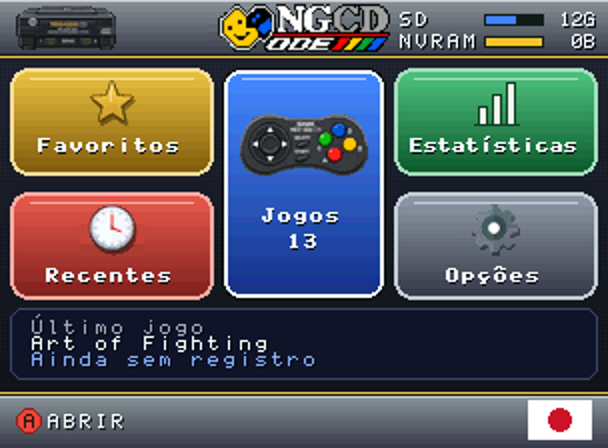</td>
<td align="center"><b>Game description</b><br>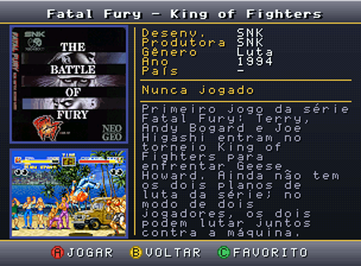</td>
</tr>
<tr>
<td align="center"><b>List</b><br>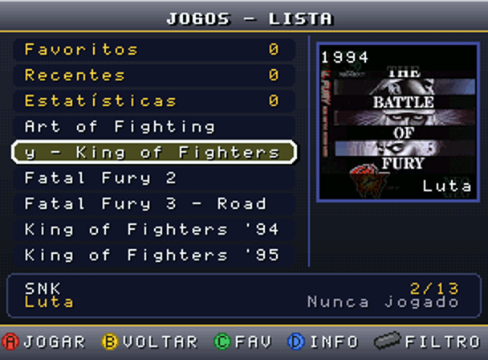</td>
<td align="center"><b>Covers</b><br>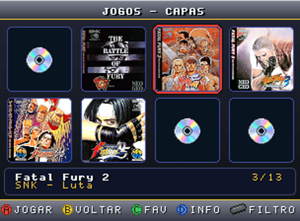</td>
</tr>
<tr>
<td align="center"><b>Carousel</b><br>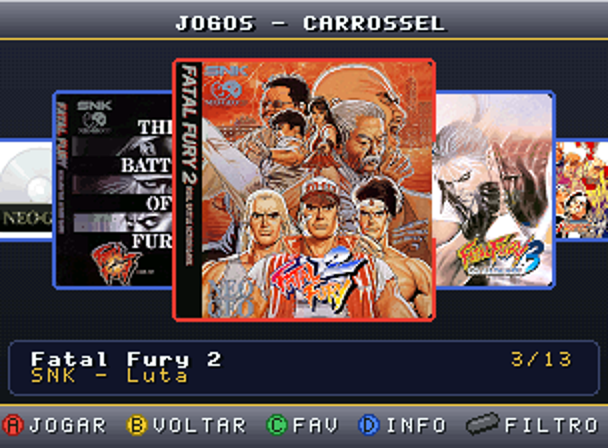</td>
<td align="center"><b>Carousel FX</b><br>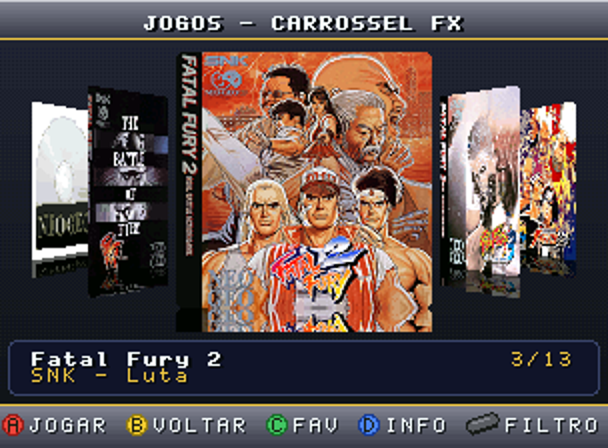</td>
</tr>
<tr>
<td align="center"><b>Showcase</b><br>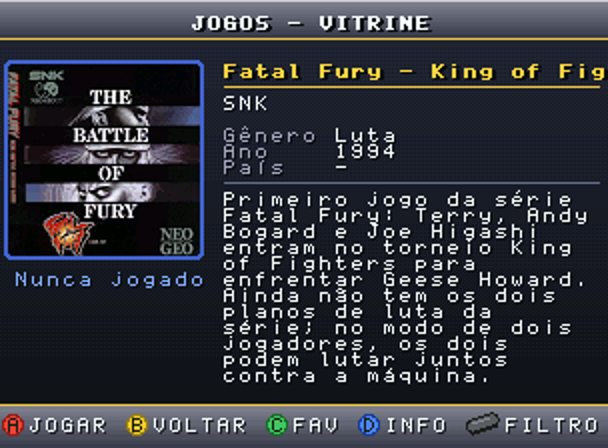</td>
<td align="center"><b>Strip</b><br>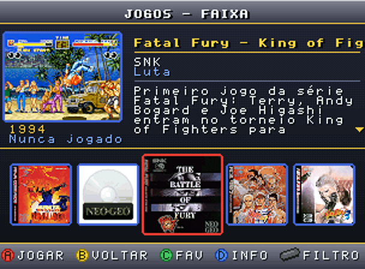</td>
</tr>
<tr>
<td align="center"><b>Options</b><br>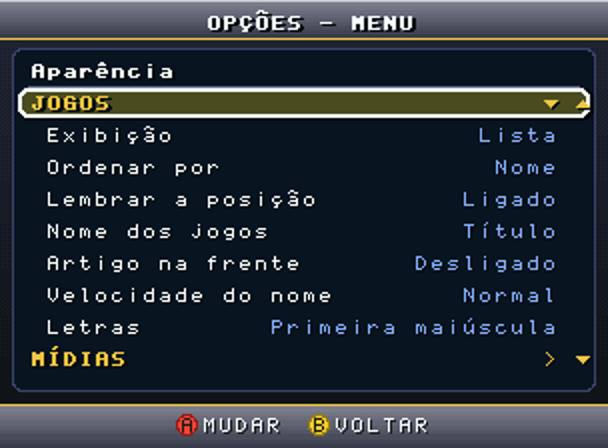</td>
<td align="center"><b>Filter</b><br>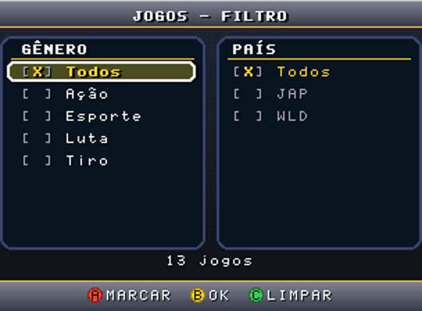</td>
</tr>
<tr>
<td align="center"><b>SD Loader device</b><br>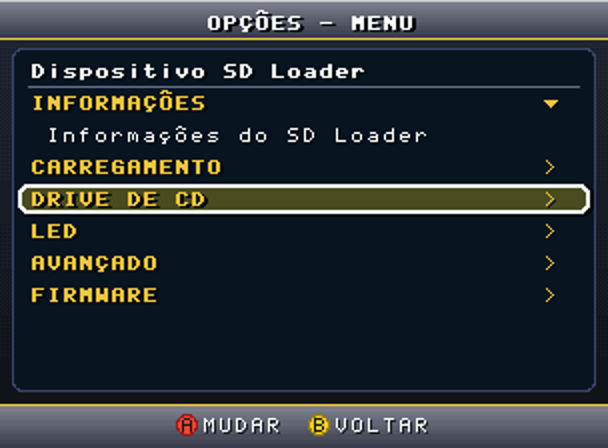</td>
<td align="center"><b>CD drive</b><br>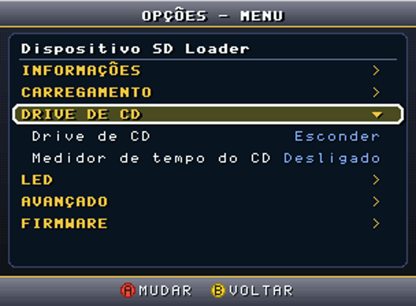</td>
</tr>
</table>

<sub>Screens shown in Portuguese; the menu also runs in English and Spanish.</sub>

---

## 🎨 Your way

The menu is **fully customizable**, and everything is saved to the card automatically (`.config/ngcdconfig.ode`, a text file you can open in Notepad).

| What you choose | Options |
|---|---|
| **How to see the games** | 6 modes: List, Covers, Carousel, Carousel FX, Showcase, Strip. |
| **Screen background** | 10 backgrounds: Default, Carbon fiber, Brushed steel, Honeycomb, Stripes, Grid, Plate, Vignette, Dots, Plain. |
| **What shows on the main menu** | Favorites, Recents, Stats and Last game: on the menu, inside Games, both or neither. SD bar, NVRAM bar and region flag: show or hide. |
| **Where the console starts** | Main menu, Games, Favorites or Recents. |
| **The list** | Sort by name or most played; official name or folder name; with or without the article in front; remember the last position or not. |
| **What shows next to the list** | Nothing, the cover, the screenshot or the video of the game, with the info over the image or below it, and the band transparency. |
| **Text** | First capital, UPPERCASE or lowercase; 5 speeds for long names; 3 languages. |
| **Sound** | Effects on or off, 10 tracks or a random one, volume bar. |
| **Idle** | Screen saver after 1, 3, 5 or 10 minutes, or off. |
| **The SD Loader** | Game region, boot logo and LED colours. |

---

## 🧩 What is in the firmware (`.WAD`): loader, MCU and CPLD

The Neo CD SD Loader has **three programmable parts**, and a single **`.WAD`** file carries all three. That is the file you copy to the root of the card to install or update.

| Part | What it is | Where it runs | What it does |
|---|---|---|---|
| **Loader** (loader firmware) | A patch of the console BIOS | On the Neo Geo CD processor (68000) | Boots the console from the card, loads games as if they were CDs, plays CD audio, the **in-game menu** (cheats, Soft DIPs), region and boot animation. **In NGCD it loads our menu by itself** at power-on. |
| **MCU** | The SD Loader microcontroller program | On the SD Loader microcontroller (STM32) | Reads the SD card (FAT32), hands "CD sectors" to the console, writes saves and lights the LEDs. **In NGCD it gained file commands**: open, read at any point (*seek*), write, list, make folders, delete and rename, and card space. |
| **CPLD** | The SD Loader hardware logic | On the SD Loader logic chip | The bridge between the console and the microcontroller. **Unchanged**: the same as the original project. |

### 🔢 Versions

| | NeoCDSDLoader original | NGCD ODE |
|---|---|---|
| File | `NSDL0011.WAD` | `NSDLZZZZ.WAD` |
| Loader | 0.11 (SD Loader folder menu) | **NGCD 12**: loads the NGCD menu at power-on |
| MCU | 00.11 | **NGCD 00.12**: file commands, *seek*, SD space |
| CPLD | 00.03 | 00.03 (the same) |
| Menu | folder list | **NGCD 1.0** (`.boot/BOOT.ISO`) |

**Why the new MCU matters:** with MCU 00.11 the console can only "read the CD" of a game. With **NGCD 00.12** the menu reads and writes files on the card. That is what allows covers, screenshots and videos outside `BOOT.ISO` (the `.media` folder), the packs, the options in `.config`, the save manager, the BIOS dump and firmware updates from the menu. The menu also works with MCU 00.11, just without those features.

The menu shows it all in *Options → SD Loader device → SD Loader info*: the loader, the MCU, the CPLD and the SD Loader serial number.

---

## 🔌 First install (how to write the first update)

1. **Format the SD card as FAT32.** File and folder names must be ASCII only (no accents).
2. **Write the card with the [page](https://cyberrep.github.io/ngcdode/)** (or with `generate_usb.py`). It copies:
   - the menu to `.boot/BOOT.ISO`;
   - the **`NSDLZZZZ.WAD`** firmware to the **root** of the card;
   - your games' covers, screenshots and texts to `.media` and `.config`.
3. **Leave only one `.WAD` in the root.** The SD Loader uses the first one it finds. Others can stay in the `.wad` folder.
4. **Turn the console on.** The SD Loader detects the new firmware and writes it by itself: the **blue LED** blinks while writing (about 1 minute, **do not turn off or remove the card**), then **green, green, green** and the console restarts with the NGCD menu.
5. **If it does not write by itself:** power on **holding A, B, C or D** to open the original SD Loader menu and choose **C → Update firmware**. It writes the `.WAD` from the root.

Once installed, the menu keeps the `.WAD` in the **`.wad`** folder (backup) and removes it from the root, so the SD Loader does not rewrite it at every power-on. Later updates are done from the menu itself: *Options → SD Loader device → Firmware → Update the loader*, which lists the `.WAD` files in the root and in the `.wad` folder for you to pick.

**To go back to the original firmware:** leave only the official `NSDL0011.WAD` in the root and update the same way.

---

## 🛟 Emergency menu (safe mode)

If something goes wrong (card without the menu, menu deleted, update cut in half), the console **always** has a way out:

| Situation | What to do |
|---|---|
| **Power on holding A, B, C or D** | Opens the **original SD Loader menu** (folder list) directly, without the NGCD menu. There, **C → Update firmware** writes the `.WAD` from the root. |
| **Warning screen** (the card has no `.boot` folder) | **A** = original SD Loader menu · **C** = update from the root `.WAD`. |
| **LED red, red, red** | There is no valid firmware in the SD Loader. **DFU** mode (USB) stays on for rescue from a computer. |

The NGCD menu is loaded from the card's `.boot` folder. Write the card again with the page and it comes back.

---

## 💡 LEDs

The SD Loader has a colour LED. **In normal use**, you choose the colours in *Options → SD Loader device → LED*:

| Option | Colours | Default |
|---|---|---|
| **Idle LED** | Red, Yellow, Green, Cyan, Blue, Magenta, White or Off | Green |
| **Loading LED** (while reading the card) | same | Blue |

The colour changes as soon as you pick it, so you can see how it looks.

**On first power-on or during an update**, the LED blinks codes (they come from the SD Loader hardware, not from the menu):

| LED | Meaning |
|---|---|
| 🔵 Blue | Writing. **Do not remove the card or turn the console off.** |
| 🟢🟢🟢 Green, green, green | Update done successfully. |
| 🔴🔴🔴 Red, red, red | No valid firmware in the SD Loader. DFU mode (USB) stays on for rescue. |
| 🔴🔴🟡 Red, red, yellow | Could not open the firmware file. Check the name, format the card or use another one. |
| 🔴🟡🔴 Red, yellow, red | The firmware file is corrupt. Copy it again or use another card. |
| 🔴🟡🟡 Red, yellow, yellow | Could not erase the loader memory (hardware fault; check the power supply). |
| 🟡🔴🔴 Yellow, red, red | Could not write the loader memory (hardware fault; check the power supply). |
| 🟡🔴🟡 Yellow, red, yellow | Could not open the firmware file. Check the name, format the card or use another one. |
| 🟡🟡🔴 Yellow, yellow, red | Write verification failed. Repeat the update. |
| 🟡🟡🟡 Yellow, yellow, yellow | The console BIOS version is not recognized. |

---

## 🎮 In game

The loader brings a menu that works **inside the games**:

| Buttons | What it does |
|---|---|
| **SELECT + START** | Game menu: cheats, Soft DIPs (difficulty, lives...) and exit. |
| **A + B + C + START** | Back to the NGCD menu. |
| **A + B + C + SELECT** | Back to the game's title screen. |

Inside the NGCD menu these shortcuts are off, so you do not leave the menu by accident.

---

## 📺 The menu

### 🏠 Main menu

Five boxes: **Favorites**, **Games**, **Stats**, **Recents** and **Options**, and below them the **Last game** panel, with the thumbnail, the name and how many times it was played.

- At the top: a picture of your console (Front Loader or Top Loader) and the **SD** and **NVRAM** (the console's save memory) bars, with the free space.
- The flag of the console region.
- On the last game panel: **A** plays, **D** opens the game sheet.
- With the CD drive turned on in the options, a **CD** box boots the disc in the drive, with a spinning disc.

### 🖼️ The 6 display modes

Choose in *Options → Appearance → Games → View*.

| Mode | What it looks like |
|---|---|
| **List** | Names on the left; on the right the cover, screenshot or **video** of the game, with year, country, genre and favorite. |
| **Covers** | A grid of covers, the selected one with a red border. |
| **Carousel** | A large cover in the centre and smaller neighbours on the sides. |
| **Carousel FX** | The side covers turned toward the centre, with a floor reflection. When you move, each cover **slides** into its neighbour's place, turning and changing size. |
| **Showcase** | A large cover on the left and, next to it, publisher, genre, year, country, play count and the whole **description**. |
| **Strip** | The **game screenshot** and description on top; below, a row of covers that moves with the d-pad. |

A game without a cover shows the default cover (the Neo Geo CD disc, with rounded corners), turned in the Carousel FX too.

### 🎮 Buttons

| Where | Buttons |
|---|---|
| **Main menu** | D-pad chooses · **A** opens |
| **Games** | **A** plays · **B** back · **C** favorite · **D** game sheet · **SELECT** (or **START**) filter |
| **Showcase and Strip** | ◄ ► change game · ▲ ▼ scroll the description |
| **Game sheet** | **A** plays · **B** back · **C** favorite · ◄ ► previous / next game · ▲ ▼ scroll the text |
| **Filter** | **A** marks · **C** clears · **B** applies and goes back |
| **Options** | ▲ ▼ move · ◄ ► or **A** change · **B** back |

### 📋 The game list

- **One game per folder**, as the SD Loader requires. The name shown is the game's **official title** (or the folder name, if you prefer).
- **Sorting**: by name or most played; with or without the article in front.
- **Remember position**: when Games opens, the selection goes back to the last game played.
- **Long names** scroll to the end by themselves, in 5 speeds (with MCU NGCD 00.12, the whole folder name, up to 63 letters).
- **Up to 200 games**, the SD Loader limit (the menu warns you if you go over).

### ⭐ Favorites, 🕑 Recents and 📊 Stats

- **Favorites**: **C** marks and unmarks, with the star animation and sound.
- **Recents**: the last games played.
- **Stats**: most-played ranking, with the total plays.
- Everything is kept on the card, in `.config/` (`ngcdfavs.ode`, `ngcdrecent.ode`, `ngcdstats.ode`).

### 🔎 Filter

**SELECT** (or **START**) in the game list opens two columns, **Genre** and **Country**, with `[ ]` / `[X]` boxes. Mark as many as you like in each; below it shows how many games pass the filter.

---

## ⚙ Options — the whole menu

Click each section to open it. Everything is saved to the card automatically (`.config/ngcdconfig.ode`).

<details>
<summary><b>🎨 Appearance</b></summary>

On the console this section is an accordion: open one group at a time.

<details>
<summary>Main menu</summary>

| Option | Values | What it does |
|---|---|---|
| Favorites | Menu and Games · Main menu · Games · Off | Where the Favorites entry shows. |
| Recents | same | Where Recents shows. |
| Stats | same | Where Stats shows. |
| Last played | same | Last game panel on the menu and entry at the top of Games. |
| Start screen | Main menu · Games · Favorites · Recents | Where the console starts. |
| SD bar | Show · Hide | The SD card space at the top. |
| NVRAM bar | Show · Hide | The console save memory space. |
| Flag | Show · Hide | The flag of the console region. |

</details>

<details>
<summary>Games</summary>

| Option | Values | What it does |
|---|---|---|
| View | List · Covers · Carousel · Carousel FX · Showcase · Strip | How you see the games. |
| Sort by | Name · Most played | The list order. |
| Remember position | On · Off | Opens Games on the last game played. |
| Game names | Title · Folder | The official title or the folder name. |
| Article in front | On · Off | "The King of Fighters" instead of "King of Fighters, The". |
| Name speed | Very slow · Slow · Normal · Fast · Very fast | Scrolling of long names. |
| Letters | First capital · UPPERCASE · lowercase | How texts are written. |

</details>

<details>
<summary>Media</summary>

| Option | Values | What it does |
|---|---|---|
| List | Off · Cover · Screenshot · Video | What shows next to the list. |
| Game info | Over the media · Below the media | Year, country, genre and star over the image or below it. |
| Band transparency | 0% · 25% · 50% · 75% · 100% | How much of the image shows behind the bands. |

</details>

<details>
<summary>Screen</summary>

| Option | Values | What it does |
|---|---|---|
| Background | Default · Carbon fiber · Brushed steel · Honeycomb · Stripes · Grid · Plate · Vignette · Dots · Plain | The background of every screen. |
| Screen saver | Off · 1 · 3 · 5 · 10 minutes | Our logo and each console, one at a time, moving across the dark screen; every 2 bounces off the edge it changes. |

</details>

</details>

<details>
<summary><b>🎵 Audio</b></summary>

| Option | Values | What it does |
|---|---|---|
| Sound effects | On · Off | Sounds for moving, going back, favoriting. |
| Background music | Off · Órbita · Pixel Rush · Neon Drive · Nebulosa · Arcade · Deserto · Templo · Horizonte · Caravana · Aurora · Random | 10 tracks, or a random one at every power-on. |
| Music volume | Bar from 0 to 10 | Changes instantly, with the music playing. |

</details>

<details>
<summary><b>💾 Storage and Saves</b></summary>

| Item | What it does |
|---|---|
| **Storage manager** | Two tabs, **Console** (the save memory) and **SD card** (`.saves`). Copies one save or all of them from one side to the other, restores and deletes. |
| **Back up the memory** | Writes the console's whole save memory to the card. |
| **Restore memory backup** | Brings a backup back, with checksum verification. |

</details>

<details>
<summary><b>🔧 SD Loader device</b></summary>

| Group | Option | What it does |
|---|---|---|
| Information | SD Loader info | Loader, MCU, CPLD, serial number and card space. |
| Loading | Game region | Japan · USA · Europe · Brazil (the console's factory region is marked). |
| | Boot logo | SD Loader (6 s) · Original CD (10 s). |
| CD drive | CD drive | Show or hide the CD box on the main menu (it boots the disc in the drive). |
| | CD timing meter | Shows how long the last card read took. |
| LED | Idle LED · Loading LED | The SD Loader LED colours. [See the LEDs](#-leds). |
| Advanced | Developer mode · Debug DIPs | For those who develop or test games. |
| Firmware | Update the loader | Lists the `.WAD` files in the root and the `.wad` folder and writes the chosen one. |

</details>

<details>
<summary><b>🕹️ Neo Geo CD console</b></summary>

| Item | What it does |
|---|---|
| **Console info** | Model (Front Loader or Top Loader), factory region and memory. |
| **Controller test** | The controller picture lights up the pressed buttons. |
| **Picture adjustment** | Test screens to set up the TV. |
| **Dump ROM** | Copies your console BIOS to the card (`.roms/`, e.g. `frontload_japao.bin`). |

</details>

<details>
<summary><b>🌐 General</b></summary>

| Item | What it does |
|---|---|
| **Language** | Português · Español · English. |
| **About** | The versions of the menu, loader, MCU and CPLD, and the thanks. |
| **Restore defaults** | Puts every option back to default. |
| **Clear recents and stats** · **Clear favorites** | Clears the menu data. |

</details>

---

## 🎬 Media: covers, screenshots and video

The page and the generator prepare everything and write it to the card's **`.media`** folder, under the game name.

| What | Size | Where it shows |
|---|---|---|
| Cover | 96 × 96 | List, Showcase, game sheet |
| Large cover | 128 × 128 | Centre of the carousels |
| Medium cover | 96 × 96 (16 palettes) | Sides of the Carousel and Carousel FX |
| Small cover | 64 × 64 | Covers grid, Strip |
| Thumbnail | 24 × 24 | Last game panel |
| Screenshot | 96 × 72 | List, Strip, game sheet |
| Video (`.ngv`) | 96 × 72, 12 frames/s, 15 s | List |

**Cover and screenshot format** (on the page, *Media → Card*): **PAK** (default) puts all the covers in `.media/covers/cover.pak` and the screenshots in `.media/screenshots/screenshots.pak`. The menu opens the pack once and goes straight to the image, instead of looking for each file in a folder with hundreds of them. **Individual** writes one file per image. When you switch formats, the page converts what is already on the card.

**Game texts:** `.config/ngcdgamelist.ode` has the official title, year, country, genre, developer, publisher and description of each game, as text (one line per game). The description is read when it is shown.

---

## 🛠️ Preparing the SD card

### 🌐 In the browser (recommended)

Open **[https://cyberrep.github.io/ngcdode/](https://cyberrep.github.io/ngcdode/)**, choose your SD card and the page copies the menu, the firmware, and your games' covers, screenshots and texts, ready to use. It works in Chrome and Edge on a computer, and the page itself has the **Step by step** and the **Manual**.

### 🛠️ With the generator (advanced)

You download **a single file**, `generate_usb.py`. It does the rest with a step-by-step wizard:

- **fixes the discs** into the format the SD Loader reads: `.chd`, `.nrg`, `.img` + `.ccd`, `.iso`/`.bin` without `.cue`, `.iso` + mp3/ogg/flac (tracks become `.wav`), `.zip`/`.7z`, a game loose in the root and a `.cue` with TABs;
- **downloads the missing art** and makes the covers and screenshots in every size;
- converts the **videos**;
- builds the **game texts**;
- writes covers and screenshots as a **pak** or loose (`--individual`);
- **copies the menu and the firmware** to the card.

It **never deletes** your games.

### 💿 Game formats

The SD Loader reads **one `.cue` per folder**, with the data track in `MODE1/2048` (`.iso`) or `MODE1/2352` (`.bin`) and audio in `.bin` or `.wav` (44100 Hz, 16 bit, stereo). **Redump-format games (`.cue` + `.bin`) run as they are.** The generator converts the rest.

---

## 📂 What the SD card looks like

```
NSDLZZZZ.WAD             the firmware (only when installing; then it moves to .wad)
King of Fighters 96/     one game per folder: the .cue and its files
Metal Slug/
.boot/                   the menu (BOOT.ISO and BOOT.CUE)
.media/                  covers, screenshots and videos (covers/cover.pak, screenshots/screenshots.pak, videos/)
.config/                 options, favorites, recents, stats and the game list (ngcd*.ode)
.saves/                  saves copied from the console and memory backups
.wad/                    firmwares already installed (backup)
.roms/                   the BIOS dumped from the console
```

## 📦 What is in this repository

```
boot/        the menu (BOOT.ISO and BOOT.CUE) — always the latest version
wad/         the NGCD firmware (NSDLZZZZ.WAD)
media/       covers, screenshots and videos already converted for the card, and the game text database
tools/       the generator (generate_usb.py)
docs/        the web page (GitHub Pages)
github/      the screens of this README
```

---

## 🙏 Credits

Built on the **[NeoCDSDLoader](https://github.com/furrtek/NeoCDSDLoader)** project (GPL-3.0): the SD Loader board, the MCU, the CPLD and the original loader. The NGCD firmware is a modified version of it, and the source code of the changes comes with this project.

We also use:

- **NeoCD-Libretro** — the emulator used as the base for testing the loader.
- **NeoGeo Development Wiki** — the hardware and BIOS documentation.
- **[libretro-thumbnails](https://github.com/libretro-thumbnails/SNK_-_Neo_Geo_CD)** — part of the covers and screenshots the page and the generator download.
- **[FFmpeg](https://ffmpeg.org/)**, **[Pillow](https://python-pillow.org/)**, **[NumPy](https://numpy.org/)** and **chdman** (MAME) — video, image and disc conversion.

### 🧪 Testers

- **[NandoGames](https://www.youtube.com/@NandoGamesBrasil)**
- **Luiz Ganso**
- **Otávio Augusto**

Games and BIOS are **not** provided.

## 🗺️ Coming next

What is already planned:

- **In-game menu** translated (English, Português, Español), with the **cheats** fixed, **Soft DIPs per game** and **save states**.
- **Cleaner firmware**: removing from the loader what the NGCD menu already does.
- **Conversion and port details** on each game sheet (where it came from, who ported it, what changed).
- **Versions on the card**: the menu saves the boot, loader and MCU versions, and the page shows what you have and marks by itself what needs updating.
- **Sliding** in the Carousel and the Strip too, like the Carousel FX.

Ideas and bugs: open an *issue* here on GitHub.

## 📝 History

The full history of the menu, the firmware and the tools is in **[CHANGELOG.md](CHANGELOG.md)**.

---

## 💛 About the project

**Made with love** by Rodrigo Tadeu "CyberRep", after the [3DO ODE menu](https://github.com/cyberrep/3doode), now for the Neo Geo CD — with a little help from Claude along the way.

☕ **Like the project? You can support it with a donation:**

- PayPal: `compras@rodrigotadeu.com.br`
- Pix (random key): `7337eb1c-74f0-4d14-97bb-b49ff0265869`

## ⚖️ License

**The menu, the page and the tools: free for personal use.** Modifying, decompiling, reverse engineering, selling (or shipping with a product that is sold) or using to train artificial intelligence is not allowed. The full text is in **[LICENSE.md](LICENSE.md)**.

**The firmware (loader and MCU)** is derived from NeoCDSDLoader and follows the **GPL-3.0**, with the source code in the `NGCD_firmware_source.zip` file of each version (Releases). Parts made by other people and their licenses are in **[THIRD-PARTY.md](THIRD-PARTY.md)**.
