# 🎮 NGCD ODE — Menu, Firmware e Mídias para o Neo Geo CD

[English](README.md) · **Português** · [Español](README.es.md)

Menu (`BOOT.ISO`), firmware (`.WAD`: loader + MCU) e ferramentas para o **Neo CD SD Loader** do projeto **[NeoCDSDLoader](https://github.com/furrtek/NeoCDSDLoader)**, por **Rodrigo Tadeu "CyberRep"**. O SD Loader troca o drive de CD do seu **Neo Geo CD** por um **cartão SD**; este projeto troca o menu atual por um **menu completo**, no padrão dos menus ODE: capas, telas, vídeos, favoritos, estatísticas, músicas e 6 modos de exibição. Tudo em **3 idiomas** (Português, Español, English), no **Front Loader** e no **Top Loader**.

> 🌐 **Comece por aqui — prepare o seu cartão SD pelo navegador, sem instalar nada:** **[https://cyberrep.github.io/ngcdode/](https://cyberrep.github.io/ngcdode/)** (Chrome ou Edge no computador). A página copia o menu e o firmware, converte capas, telas e textos dos seus jogos e grava tudo no cartão.

> **Prefere fazer no PC, ou precisa converter jogos?** Rode o **`generate_usb.py`** — um **único arquivo** que acerta os discos (`.chd`, `.nrg`, `.img`, `.iso` + mp3, `.zip`/`.7z`), baixa a arte, converte capas, telas e vídeos, monta os textos dos jogos e copia o menu e o firmware para o cartão.

**Versões atuais:** menu **1.0** · firmware **NGCD 00.12** (loader NGCD 12 · MCU NGCD 00.12 · CPLD 00.03) · [histórico completo](CHANGELOG.pt.md)

> ⚠️ **Requisito:** um **Neo CD SD Loader** (do projeto NeoCDSDLoader) instalado no console. Não funciona no CDZ. Jogos e BIOS **não** são fornecidos.

---

## ✨ Destaques

| | |
|---|---|
| 🖼️ **6 modos de exibição** | Lista, Capas, Carrossel, **Carrossel FX** (capas viradas para o centro, com reflexo no chão e deslize), **Vitrine** e **Faixa**. |
| 🎬 **Prévia em vídeo** | Parado num jogo, a imagem vira o vídeo dele, direto do cartão. |
| 🎨 **Totalmente customizável** | 10 fundos, o que aparece no menu principal, a ordem da lista, a tela em que o console liga, as letras, o som. [Veja tudo](#-do-seu-jeito). |
| ⚡ **Capas instantâneas** | Capas e telas num **pacote** (`.pak`): o menu abre o pacote uma vez e vai direto à imagem. As vizinhas já ficam na memória antes de você chegar nelas. |
| 💾 **Saves no cartão** | Gerenciador de armazenamento: copia, restaura e apaga os saves da memória do console, e faz o backup inteiro dela no cartão. |
| 📊 **Espaço do SD e da NVRAM** | Barras no topo do menu principal, com o espaço livre de cada um. |
| 🔄 **Firmware pelo console** | Atualiza o loader e o MCU pelo próprio menu, escolhendo o `.WAD`. |
| 🛟 **Sempre recuperável** | Modo de segurança ao ligar e o menu original do SD Loader a um botão de distância. [Veja](#-menu-de-emergência-modo-de-segurança). |
| 🌐 **Página web** | Prepara o cartão inteiro no navegador: menu, firmware, capas, telas, textos e opções. |

## 📋 Tudo o que ele faz

| | |
|---|---|
| 🖼️ **6 modos de exibição** | Lista, Capas, Carrossel, Carrossel FX, Vitrine e Faixa. |
| 🎬 **Prévia em vídeo** | Na lista, lida aos poucos do cartão enquanto toca. |
| ⭐ **Favoritos, Recentes e Estatísticas** | Ranking dos mais jogados e contador de partidas. |
| 🔎 **Filtro e ordenação** | Filtra por gênero e país; ordena por nome ou mais jogados. |
| 📝 **Ficha de cada jogo** | Título oficial, ano, país, gênero, desenvolvedora, produtora e a descrição completa, em 3 idiomas. |
| 💾 **Saves** | Gerenciador console ↔ cartão SD, backup e restauração da memória inteira. |
| 🧰 **Ferramentas do console** | Teste de controle, ajuste de imagem, informações do console e do SD Loader, **extração da BIOS** do seu console. |
| 💿 **Drive de CD** | Com o drive ligado junto do SD Loader, a caixa **CD** do menu principal inicia o disco que está no leitor. |
| 🔄 **Firmware pelo console** | Atualização do loader e do MCU pelo menu. |
| 🎵 **Som** | Efeitos sonoros, 10 músicas de fundo e volume em barra. |
| 🌐 **3 idiomas** | Português, Español e English, trocados na hora. |
| 🛠️ **Um arquivo só para preparar o cartão** | O `generate_usb.py` acerta os discos, baixa a arte, converte tudo e copia o menu. |

---

## 📸 Telas

<table>
<tr>
<td align="center"><b>Menu principal</b><br>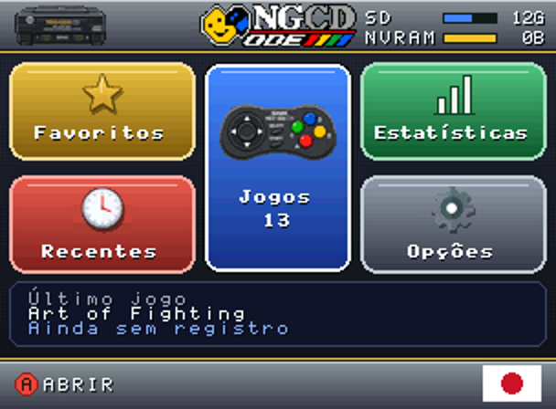</td>
<td align="center"><b>Descrição do jogo</b><br>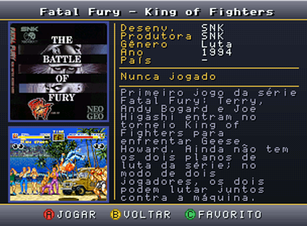</td>
</tr>
<tr>
<td align="center"><b>Lista</b><br>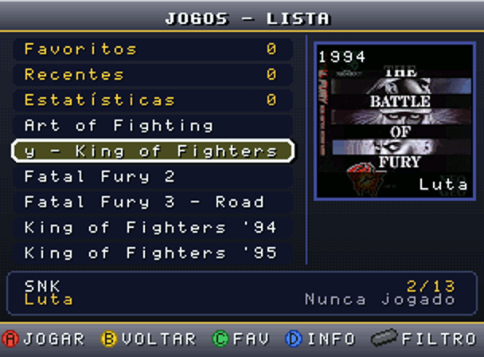</td>
<td align="center"><b>Capas</b><br>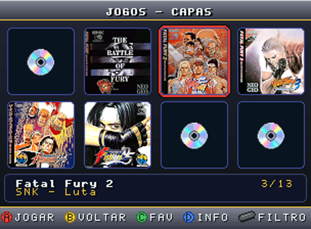</td>
</tr>
<tr>
<td align="center"><b>Carrossel</b><br>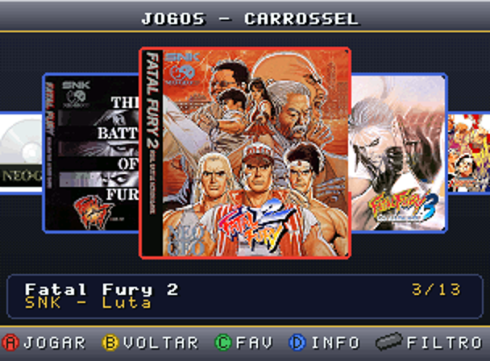</td>
<td align="center"><b>Carrossel FX</b><br>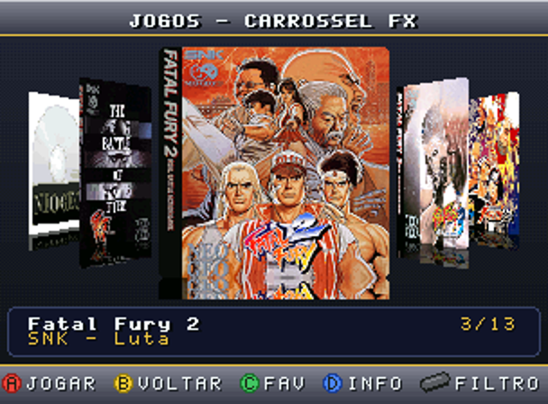</td>
</tr>
<tr>
<td align="center"><b>Vitrine</b><br>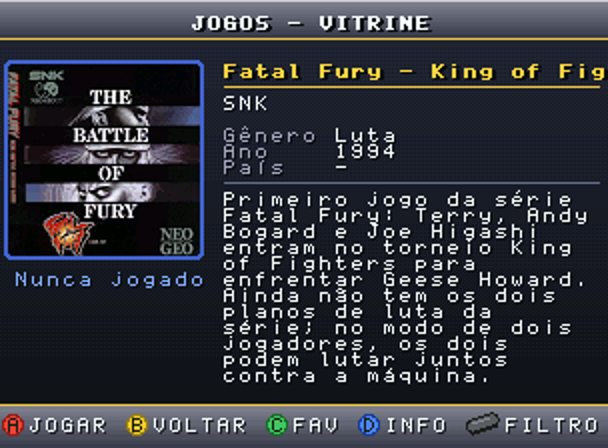</td>
<td align="center"><b>Faixa</b><br>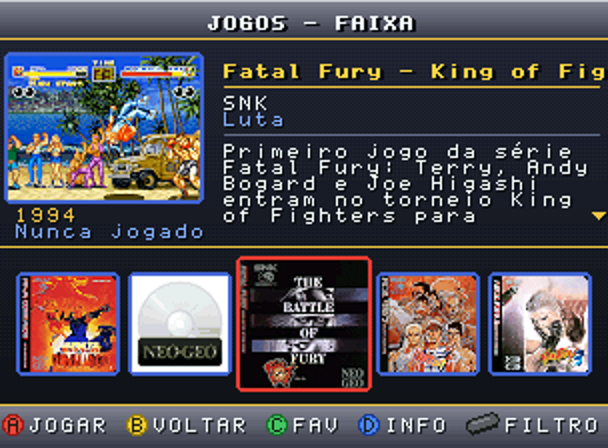</td>
</tr>
<tr>
<td align="center"><b>Opções</b><br>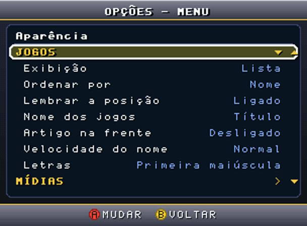</td>
<td align="center"><b>Filtro</b><br>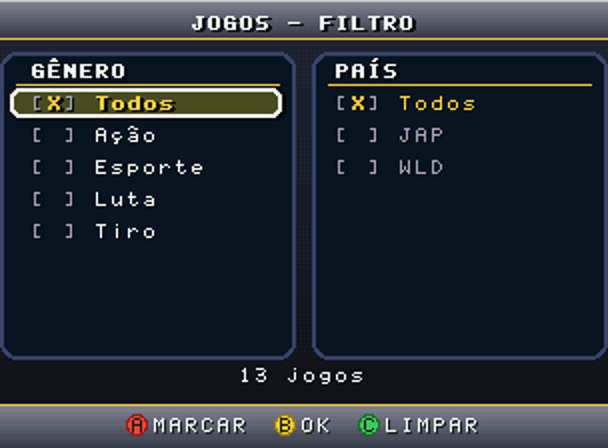</td>
</tr>
<tr>
<td align="center"><b>Dispositivo SD Loader</b><br>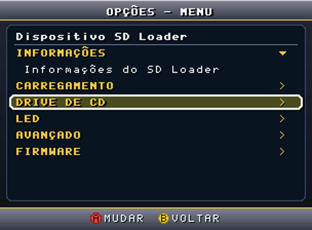</td>
<td align="center"><b>Drive de CD</b><br>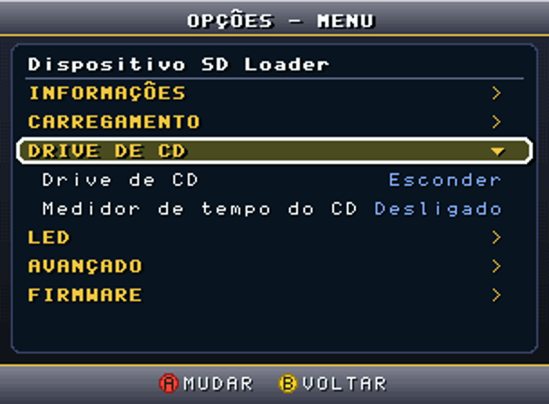</td>
</tr>
</table>

---

## 🎨 Do seu jeito

O menu é **totalmente customizável**, e tudo é gravado sozinho no cartão (`.config/ngcdconfig.ode`, um arquivo de texto que dá para abrir no Bloco de Notas).

| O que você escolhe | Opções |
|---|---|
| **Como ver os jogos** | 6 modos: Lista, Capas, Carrossel, Carrossel FX, Vitrine, Faixa. |
| **O fundo das telas** | 10 fundos: Padrão, Fibra de carbono, Aço escovado, Colmeia, Listras, Grade, Chapa, Vinheta, Pontos, Liso. |
| **O que aparece no menu principal** | Favoritos, Recentes, Estatísticas e Último jogo: no menu, dentro de Jogos, nos dois ou em nenhum. Barra do SD, barra da NVRAM e bandeira da região: mostrar ou esconder. |
| **Onde o console liga** | Menu principal, Jogos, Favoritos ou Recentes. |
| **A lista** | Ordem por nome ou mais jogados; nome oficial ou nome da pasta; com ou sem o artigo na frente; lembrando ou não a última posição. |
| **O que aparece ao lado da lista** | Nada, a capa, a tela ou o vídeo do jogo, com as informações sobre a imagem ou abaixo dela, e a transparência das faixas. |
| **Os textos** | Primeira maiúscula, MAIÚSCULAS ou minúsculas; 5 velocidades para os nomes longos; 3 idiomas. |
| **O som** | Efeitos ligados ou não, 10 músicas ou uma sorteada, volume em barra. |
| **O descanso** | Protetor de tela em 1, 3, 5 ou 10 minutos, ou desligado. |
| **O SD Loader** | Região do jogo, logo ao ligar e as cores dos LEDs. |

---

## 🧩 O que tem no firmware (`.WAD`): loader, MCU e CPLD

O Neo CD SD Loader tem **três partes programáveis**, e um único arquivo **`.WAD`** traz as três. É ele que você copia para a raiz do cartão para instalar ou atualizar.

| Parte | O que é | Onde roda | O que faz |
|---|---|---|---|
| **Loader** (firmware do loader) | Um remendo (*patch*) da BIOS do console | No processador do Neo Geo CD (68000) | Liga o console pelo cartão, carrega os jogos como se fossem CDs, toca o áudio do CD, o **menu durante o jogo** (trapaças, Soft DIPs), região e animação ao ligar. **No NGCD ele carrega o nosso menu sozinho** ao ligar. |
| **MCU** | O programa do microcontrolador do SD Loader | No microcontrolador (STM32) do SD Loader | Lê o cartão SD (FAT32), entrega os "setores do CD" ao console, grava os saves e acende os LEDs. **No NGCD ganhou comandos de arquivo**: abrir, ler em qualquer ponto (*seek*), gravar, listar, criar pastas, apagar e renomear, e o espaço do cartão. |
| **CPLD** | A lógica de hardware do SD Loader | No chip lógico do SD Loader | A ponte entre o console e o microcontrolador. **Não muda**: é a mesma do projeto original. |

### Versões

| | Original do NeoCDSDLoader | NGCD ODE |
|---|---|---|
| Arquivo | `NSDL0011.WAD` | `NSDLZZZZ.WAD` |
| Loader | 0.11 (menu de pastas do SD Loader) | **NGCD 12**: carrega o menu NGCD ao ligar |
| MCU | 00.11 | **NGCD 00.12**: comandos de arquivo, *seek*, espaço do SD |
| CPLD | 00.03 | 00.03 (o mesmo) |
| Menu | lista de pastas | **NGCD 1.0** (`.boot/BOOT.ISO`) |

**Por que o MCU novo importa:** com o MCU 00.11, o console só sabe "ler o CD" de um jogo. Com o **NGCD 00.12**, o menu lê e grava arquivos no cartão. É isso que permite capas, telas e vídeos fora do `BOOT.ISO` (pasta `.media`), os paks, as opções em `.config`, o gerenciador de saves, a extração da BIOS e a atualização do firmware pelo menu. O menu também funciona com o MCU 00.11, só que sem esses recursos.

O menu mostra tudo em *Opções → Dispositivo SD Loader → Informações do SD Loader*: o loader, o MCU, o CPLD e o número de série do SD Loader.

---

## 🔌 Primeira instalação (como gravar a 1ª atualização)

1. **Formate o cartão SD em FAT32.** Os nomes de arquivo e de pasta devem ser só ASCII (sem acentos).
2. **Grave o cartão pela [página](https://cyberrep.github.io/ngcdode/)** (ou pelo `generate_usb.py`). Ela copia:
   - o menu para `.boot/BOOT.ISO`;
   - o firmware **`NSDLZZZZ.WAD`** para a **raiz** do cartão;
   - as capas, telas e textos dos seus jogos para `.media` e `.config`.
3. **Deixe só um `.WAD` na raiz.** O SD Loader usa o primeiro que encontrar. Os outros podem ficar na pasta `.wad`.
4. **Ligue o console.** O SD Loader percebe o firmware novo e grava sozinho: o **LED azul** pisca durante a gravação (cerca de 1 minuto, **não desligue e não tire o cartão**), depois **verde, verde, verde** e o console reinicia já com o menu NGCD.
5. **Se ele não gravar sozinho:** ligue **segurando A, B, C ou D** para abrir o menu original do SD Loader e escolha **C → Update firmware**. Ele grava o `.WAD` da raiz.

Depois de instalado, o menu guarda o `.WAD` na pasta **`.wad`** (backup) e tira da raiz, para o SD Loader não regravar a cada vez que liga. As próximas atualizações são pelo próprio menu: *Opções → Dispositivo SD Loader → Firmware → Atualizar o loader*, que lista os `.WAD` da raiz e da pasta `.wad` para você escolher.

**Para voltar ao firmware original:** deixe só o `NSDL0011.WAD` oficial na raiz e atualize do mesmo jeito.

---

## 🛟 Menu de emergência (modo de segurança)

Se algo der errado (cartão sem o menu, menu apagado, atualização pela metade), o console **sempre** tem uma saída:

| Situação | O que fazer |
|---|---|
| **Ligar segurando A, B, C ou D** | Abre direto o **menu original do SD Loader** (lista de pastas), sem o menu NGCD. Ali, **C → Update firmware** grava o `.WAD` da raiz. |
| **Tela de aviso** (o cartão não tem a pasta `.boot`) | **A** = menu original do SD Loader · **C** = atualizar pelo `.WAD` da raiz. |
| **LED vermelho, vermelho, vermelho** | Não há firmware válido no SD Loader. O modo **DFU** (USB) fica ligado para o resgate pelo computador. |

O menu NGCD é carregado da pasta `.boot` do cartão. Se você gravar o cartão de novo pela página, ele volta.

---

## 💡 LEDs

O SD Loader tem um LED colorido. **No uso normal**, você escolhe as cores em *Opções → Dispositivo SD Loader → LED*:

| Opção | Cores | Padrão |
|---|---|---|
| **LED parado** | Vermelho, Amarelo, Verde, Ciano, Azul, Magenta, Branco ou Desligado | Verde |
| **LED carregando** (enquanto lê o cartão) | idem | Azul |

A cor muda na hora em que você escolhe, para ver como fica.

**Na primeira vez que liga ou durante uma atualização**, o LED pisca códigos (eles vêm do hardware do SD Loader, não do menu):

| LED | Significado |
|---|---|
| 🔵 Azul | Gravando. **Não tire o cartão nem desligue o console.** |
| 🟢🟢🟢 Verde, verde, verde | Atualização feita com sucesso. |
| 🔴🔴🔴 Vermelho, vermelho, vermelho | Não há firmware válido no SD Loader. O modo DFU (USB) fica ligado para o resgate. |
| 🔴🔴🟡 Vermelho, vermelho, amarelo | Não deu para abrir o arquivo de firmware. Confira o nome, formate o cartão ou use outro. |
| 🔴🟡🔴 Vermelho, amarelo, vermelho | O arquivo de firmware está corrompido. Copie de novo ou use outro cartão. |
| 🔴🟡🟡 Vermelho, amarelo, amarelo | Não deu para apagar a memória do loader (defeito de hardware; confira a fonte). |
| 🟡🔴🔴 Amarelo, vermelho, vermelho | Não deu para gravar a memória do loader (defeito de hardware; confira a fonte). |
| 🟡🔴🟡 Amarelo, vermelho, amarelo | Não deu para abrir o arquivo de firmware. Confira o nome, formate o cartão ou use outro. |
| 🟡🟡🔴 Amarelo, amarelo, vermelho | A conferência da gravação falhou. Repita a atualização. |
| 🟡🟡🟡 Amarelo, amarelo, amarelo | A versão da BIOS do console não é reconhecida. |

---

## 🎮 Durante o jogo

O loader traz um menu que funciona **dentro dos jogos**:

| Botões | O que faz |
|---|---|
| **SELECT + START** | Menu do jogo: trapaças, Soft DIPs (dificuldade, vidas...) e sair. |
| **A + B + C + START** | Volta ao menu NGCD. |
| **A + B + C + SELECT** | Volta à tela de título do jogo. |

Dentro do menu NGCD esses atalhos ficam desligados, para não sair do menu sem querer.

---

## 📺 O menu

### Menu principal

Cinco caixas: **Favoritos**, **Jogos**, **Estatísticas**, **Recentes** e **Opções**, e embaixo o painel do **Último jogo**, com a capinha, o nome e as vezes que foi jogado.

- No topo: a foto do seu console (Front Loader ou Top Loader) e as barras de espaço do **SD** e da **NVRAM** (a memória de saves do console), com o espaço livre.
- A bandeira da região do console.
- No painel do último jogo: **A** joga, **D** abre a ficha.
- Com o drive de CD ligado nas opções, uma caixa **CD** inicia o disco que está no leitor, com o disco girando.

### 🖼️ Os 6 modos de exibição

Escolha em *Opções → Aparência → Jogos → Exibição*.

| Modo | Como é |
|---|---|
| **Lista** | Nomes à esquerda; à direita a capa, a tela ou o **vídeo** do jogo, com ano, país, gênero e favorito. |
| **Capas** | Grade de capas, a selecionada com borda vermelha. |
| **Carrossel** | Capa grande no centro e as vizinhas menores dos lados. |
| **Carrossel FX** | As capas dos lados viradas para o centro, com reflexo no chão. Ao andar, cada capa **desliza** para o lugar da vizinha, girando e mudando de tamanho. |
| **Vitrine** | Capa grande à esquerda e, ao lado, produtora, gênero, ano, país, quantas vezes jogou e a **descrição** inteira. |
| **Faixa** | A **tela do jogo** e a descrição em cima; embaixo, uma fileira de capas que anda com o direcional. |

Jogo sem capa mostra a capa padrão (o CD do Neo Geo), também virada no Carrossel FX.

### Botões

| Onde | Botões |
|---|---|
| **Menu principal** | Direcional escolhe · **A** abre |
| **Jogos** | **A** joga · **B** volta · **C** favorita · **D** ficha do jogo · **SELECT** (ou **START**) filtro |
| **Vitrine e Faixa** | ◄ ► troca de jogo · ▲ ▼ rola a descrição |
| **Ficha do jogo** | **A** joga · **B** volta · **C** favorita · ◄ ► jogo anterior / próximo · ▲ ▼ rola o texto |
| **Filtro** | **A** marca · **C** limpa · **B** aplica e volta |
| **Opções** | ▲ ▼ anda · ◄ ► ou **A** muda · **B** volta |

### A lista de jogos

- **Um jogo por pasta**, como o SD Loader pede. O nome mostrado é o **título oficial** do jogo (ou o nome da pasta, se preferir).
- **Ordenação**: por nome ou mais jogados; com ou sem o artigo na frente.
- **Lembrar a posição**: ao abrir Jogos, a seleção volta para o último jogo jogado.
- **Nome longo** rola sozinho até o fim, em 5 velocidades (com o MCU NGCD 00.12, o nome inteiro da pasta, até 63 letras).
- **Até 200 jogos**, o limite do SD Loader (o menu avisa se passar).

### ⭐ Favoritos, 🕑 Recentes e 📊 Estatísticas

- **Favoritos**: **C** marca e desmarca, com animação e som da estrela.
- **Recentes**: os últimos jogos jogados.
- **Estatísticas**: ranking dos mais jogados, com o total de partidas.
- Tudo fica no cartão, em `.config/` (`ngcdfavs.ode`, `ngcdrecent.ode`, `ngcdstats.ode`).

### 🔎 Filtro

**SELECT** (ou **START**) na lista de jogos abre duas colunas, **Gênero** e **País**, com caixinhas `[ ]` / `[X]`. Marque quantos quiser em cada uma; embaixo aparece quantos jogos passam no filtro.

---

## ⚙ Opções — o menu inteiro

Clique em cada seção para abrir. Tudo é gravado sozinho no cartão (`.config/ngcdconfig.ode`).

<details>
<summary><b>🎨 Aparência</b></summary>

No console, esta seção é uma sanfona: abra um grupo por vez.

<details>
<summary>Menu principal</summary>

| Opção | Valores | O que faz |
|---|---|---|
| Favoritos | Menu e Jogos · Menu Principal · Jogos · Desligado | Onde a entrada dos Favoritos aparece. |
| Recentes | idem | Onde os Recentes aparecem. |
| Estatísticas | idem | Onde as Estatísticas aparecem. |
| Último jogado | idem | Painel do último jogo no menu e entrada no topo de Jogos. |
| Tela ao ligar | Menu principal · Jogos · Favoritos · Recentes | Onde o console começa. |
| Barra do SD | Mostrar · Esconder | O espaço do cartão SD no topo. |
| Barra da NVRAM | Mostrar · Esconder | O espaço da memória de saves do console. |
| Bandeira | Mostrar · Esconder | A bandeira da região do console. |

</details>

<details>
<summary>Jogos</summary>

| Opção | Valores | O que faz |
|---|---|---|
| Exibição | Lista · Capas · Carrossel · Carrossel FX · Vitrine · Faixa | O modo de ver os jogos. |
| Ordenar por | Nome · Mais jogados | A ordem da lista. |
| Lembrar a posição | Ligado · Desligado | Abre Jogos no último jogo jogado. |
| Nome dos jogos | Título · Pasta | O título oficial ou o nome da pasta. |
| Artigo na frente | Ligado · Desligado | "The King of Fighters" em vez de "King of Fighters, The". |
| Velocidade do nome | Muito lenta · Lenta · Normal · Rápida · Muito rápida | Rolagem dos nomes longos. |
| Letras | Primeira maiúscula · MAIÚSCULAS · minúsculas | Como os textos são escritos. |

</details>

<details>
<summary>Mídias</summary>

| Opção | Valores | O que faz |
|---|---|---|
| Lista | Desligado · Capa · Tela · Vídeo | O que aparece ao lado da lista. |
| Info dos jogos | Sobre a mídia · Abaixo da mídia | Ano, país, gênero e estrela por cima da imagem ou embaixo dela. |
| Transparência das faixas | 0% · 25% · 50% · 75% · 100% | O quanto aparece da imagem por trás das faixas. |

</details>

<details>
<summary>Tela</summary>

| Opção | Valores | O que faz |
|---|---|---|
| Fundo | Padrão · Fibra de carbono · Aço escovado · Colmeia · Listras · Grade · Chapa · Vinheta · Pontos · Liso | O fundo de todas as telas. |
| Protetor de tela | Desligado · 1 · 3 · 5 · 10 minutos | O nosso logo e cada console, um de cada vez, passeando pela tela escura; a cada 2 batidas na borda troca. |

</details>

</details>

<details>
<summary><b>🎵 Áudio</b></summary>

| Opção | Valores | O que faz |
|---|---|---|
| Efeitos sonoros | Ligado · Desligado | Sons de andar, voltar, favoritar. |
| Música de fundo | Desligada · Órbita · Pixel Rush · Neon Drive · Nebulosa · Arcade · Deserto · Templo · Horizonte · Caravana · Aurora · Aleatória | 10 faixas, ou uma sorteada a cada vez que liga. |
| Volume da música | Barra de 0 a 10 | Muda na hora, com a música tocando. |

</details>

<details>
<summary><b>💾 Armazenamento e Saves</b></summary>

| Item | O que faz |
|---|---|
| **Gerenciador de armazenamento** | Duas abas, **Console** (a memória de saves) e **Cartão SD** (`.saves`). Copia um save ou todos de um lado para o outro, restaura e apaga. |
| **Fazer backup da memória** | Grava a memória de saves inteira do console no cartão. |
| **Restaurar backup da memória** | Volta um backup, com a conferência da soma. |

</details>

<details>
<summary><b>🔧 Dispositivo SD Loader</b></summary>

| Grupo | Opção | O que faz |
|---|---|---|
| Informações | Informações do SD Loader | Loader, MCU, CPLD, número de série e espaço do cartão. |
| Carregamento | Região do jogo | Japão · Estados Unidos · Europa · Brasil (a de fábrica do console aparece marcada). |
| | Logo ao ligar | SD Loader (6 s) · Original CD (10 s). |
| Drive de CD | Drive de CD | Mostrar ou esconder a caixa CD no menu principal (ela inicia o disco do leitor). |
| | Medidor de tempo do CD | Mostra quanto tempo levou a última leitura do cartão. |
| LED | LED parado · LED carregando | As cores do LED do SD Loader. [Veja os LEDs](#-leds). |
| Avançado | Modo desenvolvedor · Debug DIPs | Para quem desenvolve ou testa jogos. |
| Firmware | Atualizar o loader | Lista os `.WAD` da raiz e da pasta `.wad` e grava o escolhido. |

</details>

<details>
<summary><b>🕹️ Console Neo Geo CD</b></summary>

| Item | O que faz |
|---|---|
| **Informações do console** | Modelo (Front Loader ou Top Loader), região de fábrica e memória. |
| **Teste de controle** | A foto do controle acende os botões apertados. |
| **Ajuste de imagem** | Telas de teste para acertar a TV. |
| **Extrair ROM** | Copia a BIOS do seu console para o cartão (`.roms/`, ex. `frontload_japao.bin`). |

</details>

<details>
<summary><b>🌐 Geral</b></summary>

| Item | O que faz |
|---|---|
| **Idioma** | Português · Español · English. |
| **Sobre** | As versões do menu, do loader, do MCU e do CPLD, e os agradecimentos. |
| **Restaurar os padrões** | Volta todas as opções ao padrão. |
| **Zerar recentes e estatísticas** · **Limpar os favoritos** | Limpa os dados do menu. |

</details>

---

## 🎬 Mídias: capas, telas e vídeo

A página e o gerador preparam tudo e gravam na pasta **`.media`** do cartão, com o nome do jogo.

| O quê | Tamanho | Onde aparece |
|---|---|---|
| Capa | 96 × 96 | Lista, Vitrine, ficha do jogo |
| Capa grande | 128 × 128 | Centro dos carrosséis |
| Capa média | 96 × 96 (16 paletas) | Lados do Carrossel e do Carrossel FX |
| Capa pequena | 64 × 64 | Grade de Capas, Faixa |
| Capinha | 24 × 24 | Painel do último jogo |
| Tela | 96 × 72 | Lista, Faixa, ficha do jogo |
| Vídeo (`.ngv`) | 96 × 72, 12 quadros/s, 15 s | Lista |

**Formato das capas e telas** (na página, *Mídias → Cartão*): **PAK** (padrão) junta todas as capas em `.media/covers/cover.pak` e as telas em `.media/screenshots/screenshots.pak`. O menu abre o pacote uma vez e vai direto à imagem, em vez de procurar cada arquivo numa pasta com centenas deles. **Individual** grava um arquivo por imagem. Ao trocar de formato, a página converte o que já está no cartão.

**Textos dos jogos:** `.config/ngcdgamelist.ode` traz o título oficial, ano, país, gênero, desenvolvedora, produtora e a descrição de cada jogo, em texto (uma linha por jogo). A descrição é lida na hora em que aparece.

---

## 🛠️ Preparar o cartão SD

### Pelo navegador (recomendado)

Abra **[https://cyberrep.github.io/ngcdode/](https://cyberrep.github.io/ngcdode/)**, escolha o seu cartão SD e a página copia o menu, o firmware, as capas, as telas e os textos dos seus jogos, já prontos. Funciona no Chrome e no Edge do computador, e a própria página tem o **Passo a passo** e o **Manual**.

### Pelo gerador (avançado)

Você baixa **um único arquivo**, o `generate_usb.py`. Ele faz todo o resto com um assistente passo a passo:

- **acerta os discos** para o formato que o SD Loader lê: `.chd`, `.nrg`, `.img` + `.ccd`, `.iso`/`.bin` sem `.cue`, `.iso` + mp3/ogg/flac (as faixas viram `.wav`), `.zip`/`.7z`, jogo solto na raiz e `.cue` com TAB;
- **baixa a arte que faltar** e gera as capas e as telas em todos os tamanhos;
- converte os **vídeos**;
- monta os **textos dos jogos**;
- grava as capas e telas em **pak** ou soltas (`--individual`);
- **copia o menu e o firmware** para o cartão.

Ele **nunca apaga** os seus jogos.

### Formatos de jogo

O SD Loader lê **um `.cue` por pasta**, com a trilha de dados em `MODE1/2048` (`.iso`) ou `MODE1/2352` (`.bin`) e o áudio em `.bin` ou `.wav` (44100 Hz, 16 bits, estéreo). **Jogos no formato Redump (`.cue` + `.bin`) rodam direto.** O resto, o gerador converte.

---

## 📂 Como fica o cartão SD

```
NSDLZZZZ.WAD             o firmware (só na instalação; depois vai para .wad)
King of Fighters 96/     um jogo por pasta: o .cue e os arquivos dele
Metal Slug/
.boot/                   o menu (BOOT.ISO e BOOT.CUE)
.media/                  capas, telas e vídeos (covers/cover.pak, screenshots/screenshots.pak, videos/)
.config/                 opções, favoritos, recentes, estatísticas e a lista de jogos (ngcd*.ode)
.saves/                  saves copiados do console e backups da memória
.wad/                    os firmwares já instalados (backup)
.roms/                   a BIOS extraída do console
```

## 📦 O que tem neste repositório

```
boot/        o menu (BOOT.ISO e BOOT.CUE) — sempre a última versão
wad/         o firmware NGCD (NSDLZZZZ.WAD)
media/       capas, telas e vídeos já convertidos para o cartão, e a base de textos dos jogos
tools/       o gerador (generate_usb.py)
docs/        a página web (GitHub Pages)
github/      as telas deste README
```

---

## 🙏 Créditos

Feito sobre o projeto **[NeoCDSDLoader](https://github.com/furrtek/NeoCDSDLoader)** (GPL-3.0): a placa do SD Loader, o MCU, o CPLD e o loader original. O firmware NGCD é uma versão modificada dele, e o código-fonte das modificações acompanha este projeto.

Também usamos:

- **NeoCD-Libretro** — o emulador que serviu de base para testar o loader.
- **NeoGeo Development Wiki** — a documentação do hardware e da BIOS.
- **[libretro-thumbnails](https://github.com/libretro-thumbnails/SNK_-_Neo_Geo_CD)** — parte das capas e telas que a página e o gerador baixam.
- **[FFmpeg](https://ffmpeg.org/)**, **[Pillow](https://python-pillow.org/)**, **[NumPy](https://numpy.org/)** e **chdman** (MAME) — conversão de vídeos, imagens e discos.

### 🧪 Testadores

- **[NandoGames](https://www.youtube.com/@NandoGamesBrasil)**
- **Luiz Ganso**
- **Otávio Augusto**

Jogos e BIOS **não** são fornecidos.

## 🗺️ Próximas versões

O que já está nos planos:

- **Menu durante o jogo** traduzido (Português, Español, English), com as **trapaças** arrumadas, **Soft DIPs por jogo** e **save state**.
- **Firmware mais limpo**: tirar do loader o que o menu NGCD já faz.
- **Detalhes das conversões e ports** na ficha de cada jogo (de onde veio, quem portou, o que mudou).
- **Versões no cartão**: o menu grava as versões do boot, do loader e do MCU, e a página mostra o que você tem e marca sozinha o que precisa atualizar.
- **Deslize** também no Carrossel e na Faixa, como no Carrossel FX.

Ideias e defeitos: abra uma *issue* aqui no GitHub.

## 📝 Histórico

O histórico completo do menu, do firmware e das ferramentas está em **[CHANGELOG.pt.md](CHANGELOG.pt.md)**.

---

## 💛 Sobre o projeto

**Feito com amor** por Rodrigo Tadeu "CyberRep", depois do [menu do 3DO ODE](https://github.com/cyberrep/3doode), agora para o Neo Geo CD — com uma mãozinha do Claude pelo caminho.

☕ **Curtiu o projeto? Você pode apoiar com uma doação:**

- PayPal: `compras@rodrigotadeu.com.br`
- Pix (chave aleatória): `7337eb1c-74f0-4d14-97bb-b49ff0265869`

## ⚖️ Licença

**O menu, a página e as ferramentas: uso pessoal e gratuito.** Não é permitido modificar, descompilar, fazer engenharia reversa, vender (nem entregar junto com um produto vendido) ou usar para treinar inteligência artificial. O texto completo está em **[LICENSE.md](LICENSE.md)**.

**O firmware (loader e MCU)** é derivado do NeoCDSDLoader e segue a **GPL-3.0**, com o código-fonte no arquivo `NGCD_firmware_source.zip` de cada versão (Releases). As partes feitas por outras pessoas e as licenças delas estão em **[THIRD-PARTY.md](THIRD-PARTY.md)**.
